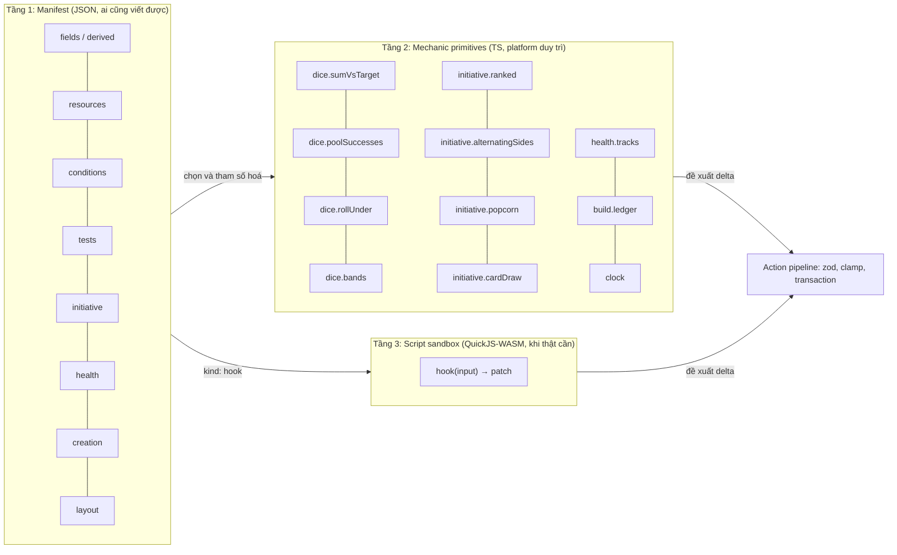
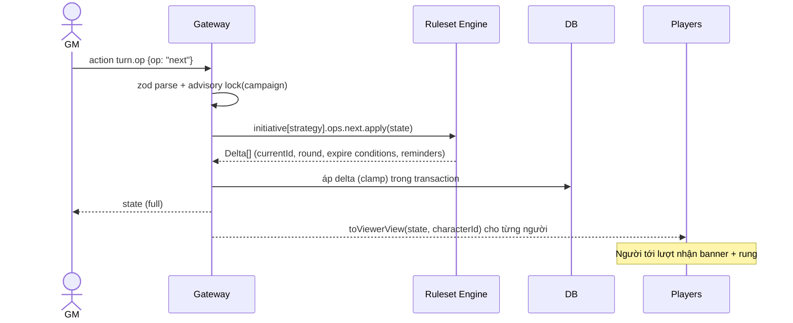

# InconsisTable: thiết kế lõi cho mọi hệ RPG

> **Trạng thái:** đề xuất (spike), chưa có code. Tài liệu này dựng trên kiến trúc hiện tại của auspex_gm
> (`docs/architecture.md`) và mở rộng nó từ một app cho *Wrath & Glory* thành nền tảng cho **mọi** RPG bàn:
> D&D 5e/2024, Pathfinder 2e, Call of Cthulhu, Blades in the Dark, PbtA, Wrath & Glory, game chiến tranh lịch sử,
> homebrew...
>
> Thuật ngữ kỹ thuật giữ nguyên tiếng Anh. "GM" dùng chung cho GM / DM / Keeper / MC.

---

**Tên:** platform tên là **InconsisTable** (org The-Inconsistent + *table*). **Auspex** được giữ làm tên của
ruleset và World Warhammer 40k: Wrath & Glory bên trong platform.

**Đã chốt (2026-10-11):**
- Tên InconsisTable.
- Có chủ phòng (`campaign.owner_user_id`, §3.6).
- Platform role ở Clerk và chỉ đổi trong Clerk Dashboard (giữ #178).
- Postgres 18.
- **Repo mới** `inconsistable`, private. Chép những phần lõi trung lập từ auspex_gm sang, không chuyển dữ liệu (chưa có
  dữ liệu cần giữ). auspex_gm vẫn chạy cho bàn W&G cho tới khi W&G được port sang.
- **5e SRD** (SRD 5.2, CC-BY-4.0) là hệ luật **đầu tiên** của InconsisTable. W&G (Auspex) port sau thành pack riêng tư,
  dùng bộ test của auspex_gm làm chuẩn đối chiếu.
- **Chưa thu phí.**
- **Có bản đồ**, nhưng là bản đồ hỗ trợ trí nhớ cho bàn thật (§3.8), không phải bàn ảo để chơi từ xa.

## 0. Tóm tắt các quyết định chính

| # | Quyết định | Lý do |
|---|---|---|
| D1 | **Giữ nguyên "xương sống" của auspex:** một đường mutation duy nhất (action zod → queue theo campaign → transaction → `authorize` → broadcast), server quyết định, counter nhận delta và bị clamp, snapshot có lọc theo từng người xem. | Mô hình này đã chạy thật tại bàn chơi và không phụ thuộc hệ luật nào. |
| D2 | **Tách lõi (Core) khỏi luật chơi (Ruleset).** Core lo phòng chơi, quyền, codex, session, reveal, realtime. Ruleset lo chỉ số, xúc xắc, initiative, máu, điều kiện, tạo nhân vật. | Hiện W&G nằm cứng trong `character`, `encounter`, `LiveState`, `Action` (xem §2.2). |
| D3 | **Ruleset là một hybrid 3 tầng:** (1) **manifest JSON** khai báo, (2) **registry "mechanic primitives"** viết bằng TS do platform duy trì, manifest chỉ *chọn và tham số hoá*, (3) **script sandbox** (QuickJS-WASM), chỉ thêm khi thật sự cần. | Manifest giúp cộng đồng và GM tự viết luật mà không cần deploy. Primitive giữ cơ chế khó (Wrath die, Seize, rút bài Savage Worlds) ở dạng code có test. Bài học từ Foundry: core sở hữu cơ chế, hệ luật chỉ cấu hình. |
| D4 | **Ba tầng tách bạch: Ruleset (luật), Content Pack (dữ liệu: quái, đồ, phép), World/Setting (bối cảnh, giao diện, từ vựng).** | Cùng luật 5e có thể chơi fantasy, steampunk hay Thế chiến II. Cùng bối cảnh 40k có thể chơi W&G hay một homebrew d20. |
| D5 | **Phiên bản bất biến, campaign "pin" phiên bản.** Encounter snapshot cả stat block lẫn phiên bản ruleset. Homebrew = fork bằng overlay. | Sửa luật không làm hỏng trận đang chơi hay nhân vật cũ. |
| D6 | **Quyền xem hai tầng:** visibility khai báo trên field (`public / party / owner / gm`, mặc định `gm`) cộng hàm view của ruleset cho những biến đổi mà visibility không diễn tả được (W&G: Corruption, mutation "Unseen", threat ẩn). | Hệ luật đơn giản chỉ cần khai báo; W&G port nguyên bộ lọc hiện có (§5.5). |
| D7 | **Ưu tiên chơi trực tiếp (in-person first):** xúc xắc thật là mặc định. App chỉ ghi kết quả, chỉ tự gieo bảng ngẫu nhiên; gieo hộ Test là tuỳ chọn theo ruleset, `wng` không bật (§4.3). Bản đồ/VTT là phần mở rộng sau. | Đó là điểm khác biệt so với Roll20 hay Foundry (§1.6). |
| D8 | **Bản quyền theo lớp nội dung:** SRD 5.1/5.2 (CC-BY-4.0), ORC, CC-BY được chia sẻ công khai. Sách có bản quyền chỉ là **nội dung riêng** của người dùng, gói trong campaign của họ. | Mở rộng nguyên tắc copyright đang có trong `CLAUDE.md`. |
| D9 | **Phân quyền 3 lớp:** platform role trong Clerk (`user / creator / moderator / admin`), ghế theo từng phòng (`gm / cogm / player`, token `player / screen`), và sở hữu theo tài nguyên (chủ phòng là `campaign.owner_user_id`). Admin toàn quyền khi mở phòng với quyền admin. | Một người vừa chơi ở phòng người khác vừa quản lý phòng và nhân vật của mình (§3.6). |
| D10 | **Postgres 18 (ghim theo minor); JSONB chỉ cho tài liệu lưu nguyên khối.** Giá trị field, resource, condition do ruleset khai báo được lưu thành hàng có kiểu. | Delta là một câu `UPDATE` nguyên tử, có khoá ngoại và ràng buộc; thêm hệ luật mới không cần migration (§5.4). |

---

## 1. Phân tích nghiệp vụ: một phòng chơi RPG gồm những gì

### 1.1 Tác nhân (actors)

Vai trò gắn với **từng campaign**, không gắn với tài khoản: một người có thể là GM ở bàn này và người chơi ở bàn khác.

| Tác nhân | Mô tả | Có trong auspex? |
|---|---|---|
| **Platform Admin** | Người vận hành dịch vụ, đứng ngoài mọi bàn (§3.1). | Có (`/admin`, `Ctx.admin`) |
| **Creator** | Tài khoản được phép tạo phòng chơi. Ở bản platform: mọi user, giới hạn theo gói (plan). | Có (`publicMetadata.role = creator`) |
| **GM (owner)** | Tạo phòng, thấy mọi thứ, soạn nội dung, quyết định reveal. | Có |
| **Co-GM** | GM phụ, có quyền giới hạn theo scope: chỉ chạy combat, hoặc sửa codex nhưng không xem secret. | **Mới** |
| **Player** | Giữ một hoặc nhiều nhân vật: nhân vật chính, tuỳ tùng, sidekick, funnel 4 nhân vật kiểu DCC. | Có (một nhân vật/ghế) |
| **Guest** | Vào bằng QR, không cần tài khoản, giữ một nhân vật (pregen, nhân vật mượn) trong một hay nhiều buổi. | Có (`access_token`) |
| **Moderator** | Xử lý nội dung bị report; không xem secret của campaign. | **Mới** |
| **Screen (TV)** | Màn hình chung chỉ đọc qua token, thấy view `party` (thanh máu Agents). Không bao giờ thấy secret. | Có (`docs/spikes/table-screen.md`) |
| **Spectator (stream)** | Người xem từ xa, chỉ thấy dữ liệu `public`. | **Mới** [Sau] |

### 1.2 Các "hộp chứa" (containers)

```
Workspace (tài khoản)
 └─ World / Setting (tuỳ chọn, dùng chung cho nhiều campaign, như West Marches)
     └─ Campaign  ── pin: Ruleset@version + Content Packs + House rules + Safety
         ├─ Adventure / Arc
         │   └─ Scene (code auspex gọi là beat): mục tiêu, cast, địa điểm, test dự kiến, encounter dự kiến
         ├─ Session (buổi chơi): ngày, điểm danh, reset pool, thưởng, recap, log
         ├─ Encounter (combat / social / chase / heist / skill challenge / bẫy)
         └─ Codex: NPC, Location (cây), Faction, Item, Handout, Quest, Lore, Calendar
```

### 1.3 Thực thể codex (đều trung lập với hệ luật)

- **NPC:** chân dung, động cơ, thái độ, quan hệ, secret, và *tham chiếu* tới stat block (bestiary, custom hoặc quick).
- **Bestiary / Threat / Monster:** dữ liệu sách (content pack), homebrew, biến thể đã scale.
- **Location:** dạng cây (hệ sao → hành tinh → thành phố → quận → phòng), có hazard.
- **Faction:** thái độ, danh tiếng, clock tiến độ.
- **Item:** catalogue, instance, tiền tệ, đồ của party.
- **Handout:** chữ, ảnh hoặc "đạo cụ" theo style của world. Audience: tất cả, một số nhân vật, hoặc ẩn.
- **Quest / Objective:** của cả party hoặc cá nhân, trạng thái open / done / failed / secret.
- **Lore, Rumour, Secret:** secret có thể được *từng nhân vật* khám phá, không chỉ toàn bàn.
- **Calendar:** ngày trong thế giới (downtime, lễ hội, đếm ngược), tách khỏi lịch chơi ngoài đời.

### 1.4 Văn hoá bàn chơi (thường bị các tool khác bỏ qua)

- **House rules:** quyết định thay luật sách, có thể bật/tắt từng luật biến thể (variant rules), và nguồn sách được phép dùng.
- **Safety tools:** Session Zero, Lines & Veils, X-Card (người chơi chạm trên điện thoại, chỉ GM nhận, ẩn danh), Open
  Door, Script Change, và Stars & Wishes cuối buổi.
- **Lịch chơi:** bình chọn ngày, ngày buổi sau (auspex đã có file `.ics`), nhắc lịch.

### 1.5 Nhịp chơi và kinh tế

Progression (XP theo buổi, milestone, advance), chia loot, quỹ party, downtime, nghỉ ngơi (short/long rest, refocus),
travel (supplies, kiệt sức), clock tiến độ kiểu Blades.

### 1.6 Điểm đau của GM với các tool hiện có (cơ hội cho InconsisTable)

1. **VTT mặc định chơi online, lấy bản đồ làm trung tâm.** Khi chơi trực tiếp, laptop thành bức tường giữa GM và người
   chơi.
2. **Khởi động mất 20 phút:** cài đặt, tạo tài khoản, đăng nhập 5 điện thoại. Auspex đã có QR guest; giữ và phát huy.
3. **Combat tracker chỉ giả định d20 + Dex.** Thiếu initiative xen kẽ hay popcorn, mob, máu nhiều track, luật chết theo
   loại kẻ địch, undo.
4. **Secret chỉ có bật/tắt.** Thiếu trạng thái "biết tên nhưng không biết chỉ số", không reveal được cho riêng một
   nhân vật.
5. **Prep nằm rải rác ở 4 tool:** Notion/World Anvil, D&D Beyond, VTT, Discord.
6. **Người chơi chuộng xúc xắc thật:** tool hoặc ép gieo số, hoặc bỏ qua kết quả. Auspex đã có "GM gọi Test → người
   chơi báo PASSED/FAILED".
7. **Pool chung** (Glory, Momentum, Doom, Bennies) phải ghi ra giấy nháp.
8. **Thủ tục cuối buổi** (XP, recap, loot, hẹn buổi sau) bị bỏ qua vì mọi người đang dọn đồ.
9. **House rules và errata nằm trong đầu GM;** đổi edition (5e → 2024) là hỏng nhân vật.

---

## 2. Từ auspex_gm hiện tại đến lõi đa hệ

### 2.1 Những gì giữ nguyên (đã trung lập)

- **Đường mutation duy nhất:** `TableGateway.onAction` → `Action.safeParse` → `serial(campaignId)` → `db.transaction`
  → `applyAction` (`authorize` → `dispatch`) → `kicks` → `broadcast(touches)`. REST vào cùng hàng đợi qua hai cửa:
  `TableGateway.run` (admin housekeeping: parse, `authorize`, `kicks`, broadcast) và `TableGateway.mutate` (invite
  accept: hàng đợi và broadcast state, không có `Action`).
- **Hai snapshot** `LiveState` / `Codex`, room `c:<id>:gm` và `c:<id>:players`, view lọc theo từng `characterId`.
- **Access:** `membership`, guest `access_token` (SHA-256), `invite` (room / character, hết hạn, `maxUses`),
  `Ctx { campaignId, role, characterId, userId, admin }`, Clerk cô lập trong `packages/auth`.
- **Codex:** adventure → beat/scene, location (cây, chống vòng lặp), NPC, faction, handout (audience, style), item, ảnh,
  `@mention`, session (recap / GM notes).
- **Character library** (nhân vật ngoài campaign), **content pack** (key, cha trước con), export/import có remap id.
- **Rate limit**, `admin_event`, `image.store.ts` (điểm thay sang S3).

### 2.2 Những gì là W&G và phải thành Ruleset module

| Khu vực | Đang mã hoá ở | Thành phần ruleset tương ứng |
|---|---|---|
| Pool Wrath/Glory/Ruin, reset đầu buổi | cột `campaign.glory/ruin`, `character.wrath`, `poolMax`, `session.start` | `resources[]` với `scope` (entity/party/gm) và `resetOn` |
| Chỉ số nhân vật | cột `wounds/shock/xp…`, `CharacterStats`, `deriveStats` | `entities.character.fields` + `derived` (biểu thức) |
| Tier | `campaign.tier` 1–5 | field cấp campaign do ruleset khai báo (`campaignFields`) |
| Initiative xen kẽ, Seize, ambush | `encounter.lastSide/seizedSide`, `sideUpNext`, `canSeize`, `canAct` | primitive `initiative.alternatingSides` |
| Loại kẻ địch, luật chết | `ThreatClass`, `threatStatus/pcStatus`, mob | `health.tracks` + `health.states` + `mob` |
| Condition | `CONDITIONS`, `TIMED_CONDITIONS`, reminder | `conditions[]` có effects, thời hạn, reminder |
| Test (pool d6, DN, Icon, Wrath die) | `test-call.ts`, `test_call`, `DN_TABLE` | `tests{}`: primitive `dice.poolSuccesses` |
| Corruption / Mutation | `corruption.ts`, `mutation.ts` | resource + roll table + effects |
| Tạo nhân vật, XP ledger | `build.ts` (~2500 dòng), `creation/*.json` | `creation[]` (các bước) + `progression` + primitive `build.ledger` |
| Wargear, requisition | `wargear.ts`, `requisition.ts` | entity `item` + primitive `economy.requisition` |
| Nguồn sách, cite | `source.ts` `SOURCES` | `sources[]` trong manifest + `cite` trên mọi entry luật |
| Sát thương và trạng thái chết | `pcHit` (Annihilation khi quá 2× Max Wounds, Wound khi đang Dying thành Traumatic, Shock khi Exhausted thành Wounds, Dying thêm Prone), mob mất thành viên, `pcStatus`/`threatStatus` đọc `wounds > maxWounds` | primitive `health.hit`: track sát thương **không bị chặn trên**, op đọc và ghi trong lock (§5.4) |
| Combatant W&G | `mobStart` (nhắc Resolve DN 3, trần hồi máu), `personalRuin`, `expiring` (hết ở cuối lượt kế của chính nhân vật), `threatClass` | cột `mob_start`, `threat_class`; `personalRuin` là `actor_resource`; condition hết hạn `ownTurnEnd` |
| Bộ lọc người chơi | `toPlayerView`/`toPlayerCodex` **biến đổi** dữ liệu: Corruption thành 0 hay `CHAOS_SPAWN_AT` khi Lost, mutation "Unseen", `UNSEEN_ID`, Ruin gửi 0, `audience` thành `[self]` | primitive `view.wng`, port nguyên code hiện có (§5.5) |
| Field W&G trong codex | `beat.ruin/glory/spends/tests`, `item.mods`, `test_call.test` (jsonb, zod) | ruleset khai báo; lưu theo chính sách JSONB §5.4 |

> **Kiểm chứng tính tương đương (parity test):** W&G trở thành **manifest đầu tiên** (`wng@1.0.0`). Mọi test hiện có
> trong `packages/shared` phải chạy qua engine chung mà vẫn xanh. Đây là điều kiện để coi việc tách lõi là thành công.

---

## 3. Chức năng theo vai trò

Ký hiệu: **[MVP]** = bản đầu, **[Sau]** = giai đoạn sau. **[Có]** = auspex đã có, chỉ cần tổng quát hoá.

### 3.1 Admin Console (người vận hành platform)

| Mục | Chức năng |
|---|---|
| **Dashboard** | [MVP] số user, phòng đang chạy, session live, lỗi, dung lượng. [Sau] biểu đồ dùng theo ruleset |
| **Users** | [Có] danh sách, vai trò, xoá ghế. [MVP] khoá/mở tài khoản, đổi plan, xem campaign của user. [MVP] export/xoá dữ liệu (GDPR), bắt buộc trước khi mở đăng ký công khai; xoá thì ẩn danh nhân vật `retired` và id người dùng trong log. [Sau] impersonate chỉ đọc: một chế độ `Ctx` riêng chỉ có quyền đọc, ghi audit |
| **Rooms / Campaigns** | [Có] danh sách game, housekeeping action. [MVP] lọc theo ruleset, chủ phòng, hoạt động gần nhất; **chuyển quyền chủ phòng** (người nhận chấp nhận) và phòng mất chủ; archive/unarchive; force-end session bị treo |
| **Characters** | [MVP] tìm nhân vật theo user/campaign, xem nhân vật lỗi migrate. Không có soft delete: #178 đã loại vì giữ mãi nội dung có bản quyền và dữ liệu người chơi |
| **Rulesets & Packs** | [MVP] duyệt ruleset/pack công khai (license phải là SRD/ORC/CC-BY), feature flag theo ruleset. [Sau] kho cộng đồng, CI kiểm tra lại mọi manifest khi lên phiên bản core |
| **Moderation** | [MVP] nút "report" trên nội dung chia sẻ (handout, ảnh, trang campaign công khai), hàng đợi xử lý, gỡ nội dung. [Sau] quét ảnh tự động, quy trình DMCA |
| **Audit log** | [Có] `admin_event` cho 7 action housekeeping (`ADMIN_ACTIONS`). [MVP] thêm: admin mở phòng không ghế, chuyển chủ phòng, gỡ nội dung, khoá tài khoản |
| **Quotas & Plans** | [MVP] giới hạn số campaign/user, người chơi/phòng, dung lượng upload. [Sau] gói trả phí (thường chỉ GM trả, người chơi miễn phí) |
| **Hệ thống** | [Sau] status page, backup/restore theo campaign, telemetry |

### 3.2 Workspace của người dùng (thay lobby): "quản lý phòng, campaign, nhân vật của tôi"

- **Phòng/Campaign của tôi:** đang làm GM, đang chơi, đã archive. Nhân bản (clone) một campaign. Import/export.
- **Nhân vật của tôi:** library nhân vật theo ruleset (mở rộng `library_character`), đưa vào campaign.
- **Ruleset & Pack của tôi:** homebrew riêng (fork từ ruleset gốc), pack nội dung riêng (sách mình sở hữu).
- **World của tôi:** bối cảnh dùng chung nhiều campaign: lore, bản đồ ảnh, theme giao diện, từ vựng.
- **Tạo phòng mới:** wizard ở §3.3.

### 3.3 Wizard dựng một game hoàn chỉnh (mở rộng NEW CAMPAIGN hiện tại)

| Bước | Nội dung | Ghi chú |
|---|---|---|
| 1. **Hệ luật** | Chọn ruleset + phiên bản (5e SRD 2024, PF2e ORC, W&G private, PbtA, "Freeform"), bật content pack | "Freeform" = ruleset tối thiểu (chỉ ghi chú + một track máu) cho game tự chế |
| 2. **Bối cảnh** | Chọn World (hoặc tạo mới): fantasy, 40k, WW2, cyberpunk... Theme giao diện, từ vựng (Agent/Threat hay Party/Monster) | Theme hiện tại "Imperial Manuscript" trở thành theme của World 40k |
| 3. **Quy mô và mức khởi đầu** | Cấp/tier khởi đầu, cách tạo chỉ số (point buy / array / roll), nguồn sách được phép | Lấy từ `manifest.options` |
| 4. **Table talk / Session Zero** | Thể loại, tông (u tối, hài, kinh dị), Lines & Veils, bật X-Card, kỳ vọng | Có sẵn `kind[]`, `limits[]`; tổng quát hoá |
| 5. **House rules** | Bật/tắt variant rules của ruleset (flanking, encumbrance...), viết house rule kèm patch | Lưu bảng `house_rule`, áp như overlay (§4.5) |
| 6. **Party** | Slot nhân vật, pregen, QR phòng, link mời theo nhân vật, cho phép guest | [Có] RoomInvite; giữ nguyên |
| 7. **Lịch** | Ngày giờ buổi đầu, địa điểm, nhắc lịch | [Có] `.ics` |
| 8. **Adventure đầu tiên** | Trống, từ template, hoặc từ pack (one-shot) | Pack load qua action thường như `seed.ts` |

Mỗi bước đều bỏ qua được. **"Quick game":** chọn ruleset → QR → chơi trong dưới 2 phút.

### 3.4 Chức năng GM (tablet/laptop)

| Module | MVP | Sau |
|---|---|---|
| **SETUP** | Checklist sẵn sàng, đổi ruleset option, house rules, safety, export | Nâng phiên bản ruleset có dry-run diff |
| **PREP** | Adventure → scene; scene gắn NPC, location, handout, test dự kiến, encounter dự kiến; encounter builder từ bestiary với **ngân sách độ khó** do ruleset định nghĩa (5e: XP budget; W&G: threat budget) | Checklist prep kiểu "Lazy DM", generator ngẫu nhiên, sơ đồ scene kéo thả |
| **LIVE (TRACK)** | Bắt đầu/kết thúc session (reset resource theo `resetOn`, điểm danh), scene đang diễn ra, nút reveal; **Gọi Test** theo dice mechanic của ruleset; duyệt **request** của người chơi (tiêu pool, reaction) | Log dòng thời gian, đồng hồ nhịp, theo dõi spotlight ("người chơi B lâu chưa được hành động") |
| **Combat tracker** | Initiative theo strategy của ruleset; delta máu/resource; condition có thời hạn tự hết; reminder đầu/cuối lượt; ẩn combatant; mob; command line [Có]; **undo phía server**: đảo delta `after − before` đã ghi ở `session_event` (P1) | Legendary/lair action, reaction |
| **Bestiary / Threat** | Tìm, thêm N con tự đánh số, snapshot; threat builder custom [Có] | Scale/template, quick mook |
| **Secret / Reveal** | Hiển thị theo từng entry: ẩn / đã reveal / reveal cho từng nhân vật; "chỉ thanh máu" [Có] | Reveal một phần (biết tên, chưa biết stat), secret khám phá theo từng nhân vật |
| **Clocks** | Clock 4/6/8 ô, đếm ngược, track Doom/Threat | Clock liên kết (lượt faction) |
| **Bảng ngẫu nhiên** | d6/d66/d100/có trọng số, gieo xong dán vào ghi chú [Có `roll-table.ts`] | Bảng lồng nhau, oracle (Mythic), sinh tên |
| **CODEX** | NPC, location, faction, item, handout (5 style [Có] → style theo World), quest, lore, ảnh, @mention, tìm kiếm [Có] | Đồ thị backlink, chỉnh sửa song song với co-GM |
| **PARTY** | Session và recap, mời (QR/link), guest, sheet nhân vật (GM sửa / override), trao XP và loot | Hàng đợi duyệt thưởng, danh tiếng faction |
| **RULES** | Tra cứu condition/trait theo ruleset, chạm là đọc, có cite trang [Có] | Liên kết tới PDF riêng của GM (relay `book:*` [Có]) |
| **Safety** | Nhận tín hiệu X-Card ẩn danh, xem Lines & Veils ngay trong prep | Phản hồi Stars & Wishes |
| **Cuối buổi** | Wizard gom tất cả: XP, recap, loot, ngày buổi sau | Tự soạn nháp recap từ log |
| **Print** | Thẻ threat, item, handout [Có, react-pdf] → layout theo ruleset | |

### 3.5 Chức năng người chơi (điện thoại)

| Module | MVP | Sau |
|---|---|---|
| **Vào phòng** | QR/link → chọn hoặc nhận nhân vật; guest không cần tài khoản; tự kết nối lại [Có] | Phòng chờ duyệt, nhiều nhân vật, spectate |
| **Builder** | Các bước tạo nhân vật theo `manifest.creation`, kiểm tra hợp lệ, XP/point ledger; **lối thoát nhập tay** | Import D&D Beyond / Pathbuilder JSON, wizard lên cấp |
| **SHEET** | Render từ `layout` của ruleset (phone-first); nút ± chỉ trên resource có `editableBy: owner`/`ownerSpendOnly`, còn lại xin qua request; số dẫn xuất chạm vào thấy cách tính ("vì sao Defence = 5?") kèm cite | Chế độ offline |
| **Resource / Phép** | Slot, điểm, prepared/known, metacurrency (Inspiration, Fate, Glory) | Thẻ phép (concentration, thành phần) |
| **Inventory** | Đồ, số lượng, đang trang bị, tiền | Encumbrance, attunement, kho party có log |
| **FIGHT** | Trận đấu theo mức GM cho thấy; banner "đến lượt bạn" + rung [Có] | |
| **Test được gọi** | Nhận prompt, xem pool/DC, gieo **xúc xắc thật**, báo kết quả [Có, tổng quát hoá theo mechanic] | Gieo số (GM bật), chỉ ở ruleset cho phép; `wng` giữ báo PASSED/FAILED (rules-flow §11.143) |
| **Request** | Xin tiêu pool, dùng reaction; GM duyệt [Có `spend_request`] | Xin tiêu XP, hành động downtime |
| **INTEL** | NPC, location, faction đã biết; handout; quest; recap; buổi tới [Có] | Bản đồ quan hệ, bảng tin đồn |
| **Ghi chú** | Ghi chú riêng (chỉ chủ nhân vật thấy) | Nhật ký party chung |
| **Safety** | Nút X-Card ẩn danh | |
| **RULES** | Tra cứu theo ruleset [Có] | |

---

### 3.6 Phân quyền (RBAC + ownership)

**Yêu cầu:**
- Một tài khoản vừa là người chơi ở phòng của người khác, vừa quản lý các phòng và nhân vật do chính mình tạo.
- Admin có toàn quyền.
- Auspex đã có nền móng: role theo `membership`, token cho guest và màn hình TV, `Ctx.admin`, `PLAYER_ACTIONS`,
  `authorize()`. Phần này biến nó thành một hệ phân quyền tường minh, và ghi rõ chỗ nào đảo một quyết định đã có.

**Ba lớp:**

```
1. Platform role (toàn hệ thống)  Clerk publicMetadata.role: user | creator | moderator | admin
2. Ghế trong phòng (theo campaign) membership.role: gm | cogm | player   hoặc   access_token.role: player | screen
3. Sở hữu (theo tài nguyên)       campaign.owner_user_id; owner_user_id trên library_character, world, ruleset, pack
```

Vì ghế nằm trên `membership` chứ không nằm trên tài khoản, cùng một người có thể là chủ phòng ở phòng A, `player` ở
phòng B và `cogm` ở phòng C. `Ctx` được resolve theo `campaignId` của socket, như `resolveCtx` đang làm.

**Platform role: Clerk vẫn là nguồn sự thật.** Issue #178 và PR #222 đã quyết "roles stay in Clerk", và
`docs/architecture.md` ghi "roles are only ever changed in Clerk". Thiết kế giữ quyết định đó:
- `app_user.role` vẫn chỉ là bản hiển thị. Api chỉ đọc role từ session token đã verify, không bao giờ từ client.
- Thêm giá trị `moderator` vào `publicMetadata.role`.
- **Đã chốt:** role chỉ đổi trong Clerk Dashboard. Admin Console chỉ hiển thị role, không có nút đổi.
- Webhook `user.updated` của Clerk ngắt mọi socket của user đó trên mọi node (room `user:<id>` qua Redis adapter).
  Socket kết nối lại với role mới, không phải chờ token làm mới (~60 s).
- Khoá tài khoản là cột `app_user.status`, đọc ở mỗi lần connect socket và mỗi request REST.

| Role | Quyền |
|---|---|
| `user` | Nhận lời mời, chơi, sở hữu nhân vật library, world, ruleset/pack homebrew của mình. Tạo campaign trong quota của gói |
| `creator` | [Có] Như `user`. Ở platform mở thì mọi user đều tạo được phòng, nên role này chỉ còn ý nghĩa nếu quota cần |
| `moderator` | Hàng đợi report, gỡ nội dung đã chia sẻ, khoá tạm tài khoản `user`/`creator`. Không khoá được moderator hay admin. Không vào được campaign |
| `admin` | **Toàn quyền**, theo hai cách bên dưới |

**Admin toàn quyền nhưng phải chủ động.** Giữ đúng cách `resolveCtx` làm hôm nay:
- **Admin có ghế ở một bàn** (đang chơi ở phòng bạn bè) nhận quyền **của ghế đó**. Không tự thấy secret của GM.
- **Admin mở phòng với quyền admin** (OPEN AS ADMIN trên Admin Console, không ghế): `Ctx.seat.kind = "admin"`, có mọi
  quyền trong phòng đó.
- Như hôm nay, chỉ 7 action housekeeping (`ADMIN_ACTIONS`) ghi `admin_event`; lượt chạm Wounds của admin không ghi.
  Thêm một dòng `admin_event` khi admin mở phòng không có ghế.
- Hiện cho GM thấy dòng "Admin đã truy cập" sẽ đảo quyết định đã ghim ở #178 (admin vô hình trong PARTY), nên đây là
  câu hỏi mở (§8), chưa phải thiết kế.
- `member.seat` (gán ghế cho một user) vẫn chỉ dành cho admin.

**Chủ phòng là một cột, không phải một role (đã chốt 2026-10-11).** Issue #178 ghi "there is no owner": GM nào cũng
archive được, và chỉ xoá được game đã archive sau khi gõ tên. Yêu cầu mới ("người dùng quản lý các phòng do mình
tạo") cần một chủ phòng, nên thiết kế **đảo một phần quyết định đó**:
- `campaign.owner_user_id` là nguồn duy nhất. Chủ phòng luôn có một ghế `gm`. `membership.role` không có giá trị
  `owner`, nên không thể có hai chủ phòng.
- Chỉ chủ phòng (hoặc admin): xoá phòng, chuyển chủ phòng, bổ nhiệm và gỡ `gm`/`cogm`, đổi ruleset.
- Giữ nguyên: GM nào cũng archive và unarchive được. Xoá vẫn phải archive trước rồi gõ tên.
- Chuyển chủ phòng tạo một lời mời `ownership_transfer`; người nhận phải chấp nhận.
- Chủ phòng không thể bị gỡ, chỉ chuyển quyền. Tài khoản chủ phòng bị xoá thì `owner_user_id` thành `null`
  (`ON DELETE SET NULL`), và phòng vào hàng đợi để admin giao chủ mới hoặc archive.
- Không có soft delete. #178 đã loại nó vì nó giữ mãi nội dung có bản quyền và dữ liệu người chơi.

**Ghế trong phòng**

| Ghế | Ai | Quyền chính |
|---|---|---|
| `gm` | GM đầy đủ; chủ phòng là một `gm` | Chuẩn bị nội dung, chạy session và combat, reveal, mời và gỡ `player`, sửa mọi sheet, archive |
| `cogm` | GM phụ có `scopes[]` | Chỉ những scope được giao: `combat`, `codex`, `codex.secrets`, `party`, `session`. Không tự đổi scope của mình |
| `player` | Người chơi có tài khoản | Nhân vật của ghế mình (một hoặc nhiều, `membership_character`), request, ghi chú riêng, X-Card |
| token `player` | Guest qua QR | Như `player` cho nhân vật gắn với token [Có] |
| token `screen` | Màn hình TV | Chỉ đọc view `party` [Có]: thanh máu Agents hiện trên TV; không có `/rules`, `/creation`, `book:*` (`docs/spikes/table-screen.md`) |

**Permission là dữ liệu.** Mỗi permission có dạng `tài nguyên:hành động[:own]`, định nghĩa một lần bằng `z.enum` trong
`core-schema`. Ghế ánh xạ tới tập permission bằng bảng hằng.

```ts
export const Permission = z.enum([
  "campaign:update", "campaign:archive", "campaign:delete", "campaign:transfer", "campaign:ruleset",
  "member:invite", "member:remove", "member:appoint", "member:seat",
  "session:run", "encounter:run", "test:call",
  "codex:read", "codex:write", "codex:read_secret", "codex:reveal",
  "character:edit:any", "character:edit:own", "character:create",
  "request:send", "request:resolve", "safety:signal",
]);
export const OWNER_ONLY = new Set<Permission>(["campaign:delete", "campaign:transfer", "campaign:ruleset", "member:appoint"]);

// Thuần, có test; chạy ở web để ẩn nút, nhưng chỉ kết quả ở api có giá trị.
export function canInCampaign({ ctx, perm, target }: { ctx: Ctx; perm: Permission; target?: Target }): boolean {
  if (ctx.seat.kind === "admin") return true;                       // OPEN AS ADMIN, không ghế
  if (perm === "member:seat") return false;                         // chỉ admin
  if (OWNER_ONLY.has(perm)) return ctx.userId !== null && ctx.userId === ctx.campaignOwnerId;
  if (perm.endsWith(":own")) {                                      // ":own" luôn cần target và một ghế đang sống
    return target?.actorId !== undefined && OWN_GRANTS[ctx.seat.role].has(perm)
      && ctx.seat.characterIds.includes(target.actorId);           // so theo ghế, không theo userId
  }
  if (!SEAT_GRANTS[ctx.seat.role].has(perm)) return false;
  return ctx.seat.role !== "cogm" || COGM_SCOPES_FOR[perm].some((s) => ctx.seat.scopes.includes(s));
}
```

- **"Của mình" tính theo ghế.** Guest không có `userId` nhưng token của họ mang `characterIds`. Người đã rời phòng
  không còn ghế nên không còn `:own`. Pregen chưa ai nhận không thuộc về ai.
- **Thao tác lên thành viên xét cả người bị tác động.** `member:remove` chỉ gỡ được ghế thấp hơn mình (`gm` gỡ
  `player`; chỉ chủ phòng gỡ `gm`/`cogm`). Lời mời mang role không cao hơn quyền của người mời.
- **`authorize()` = state guard + `can()` + validator của op.**
  - **State guard**, giữ như hiện nay: game đã archive thì chỉ còn `ARCHIVED_OPEN`.
  - **`can()`** xét permission như trên.
  - **Validator của op** lo những luật không phải quyền:
    - chiều của delta: `character.supply` cho người chơi tiêu Wealth, Ammo nhưng không tự cộng, p.206, §11.57;
    - nhân vật phải thuộc ghế: `spend.request`, `test.report`.
- **Quyền trên field:** `character:edit:own` chỉ sửa được field và resource có `editableBy: owner` (hoặc
  `ownerSpendOnly`: chỉ được giảm) trong manifest. Như hôm nay, phần lớn counter của người chơi đi qua `request` để
  GM duyệt.
- **Codex ghi theo patch.** `codex.save` hôm nay ghi đè cả document, và zod mặc định `secrets`/`gmNotes` là `""`. Nếu
  giữ cách đó, một `cogm` không có `codex.secrets` sẽ xoá trắng secret mỗi lần lưu. Vì vậy server giữ nguyên mọi field
  mà người gửi không được đọc.

**Ownership: nhân vật thuộc về ai**

- `library_character.owner_user_id`: nhân vật ngoài campaign, chỉ chủ sở hữu sửa.
- Đưa vào campaign tạo một **bản sao** (`character.owner_user_id` = người chơi) gắn vào ghế qua `membership_character`.
- Khi người chơi rời phòng, nhân vật **ở lại** với trạng thái `retired`, vì GM còn cần.
  - Người chơi xuất được một bản sao về library qua REST riêng.
  - Bản sao chỉ chứa những gì view người chơi thấy, không có override hay objective của GM. Pack được tham chiếu
    bằng khoá chứ không chép nội dung.

**Workspace nhìn từ quyền** (§3.2): truy vấn `membership` của user rồi nhóm lại.
- "Phòng của tôi": `campaign.owner_user_id` là mình.
- "Tôi làm GM": `gm`/`cogm`.
- "Tôi đang chơi": `player`, kèm nhân vật.
- "Nhân vật của tôi": library cộng các bản trong campaign mà mình sở hữu.
- "Homebrew của tôi": world, ruleset, pack.

**Ma trận rút gọn** (✔ = có quyền, `own` = nhân vật của ghế mình, `scope` = khi được giao scope đó)

| Hành động | chủ phòng | gm | cogm | player | screen | moderator | admin (OPEN AS ADMIN) |
|---|---|---|---|---|---|---|---|
| Xoá phòng (đã archive, gõ tên) | ✔ | | | | | | ✔ |
| Chuyển chủ phòng (người nhận chấp nhận) | ✔ | | | | | | ✔ |
| Bổ nhiệm / gỡ `gm`, `cogm`; đổi ruleset | ✔ | | | | | | ✔ |
| Archive / unarchive; house rules, option | ✔ | ✔ | | | | | ✔ |
| Mời / gỡ `player` | ✔ | ✔ | scope `party` | | | | ✔ |
| Gán ghế cho user (`member.seat`) | | | | | | | ✔ |
| Chạy session, combat | ✔ | ✔ | scope `session`/`combat` | | | | ✔ |
| Sửa codex (patch) | ✔ | ✔ | scope `codex` | | | | ✔ |
| Đọc secret, ghi chú GM | ✔ | ✔ | scope `codex.secrets` | | | | ✔ |
| Sửa sheet | ✔ | ✔ | scope `party` | `own`, theo `editableBy` | | | ✔ |
| Gửi request, X-Card | | | | ✔ | | | |
| Xem | tất cả | tất cả | theo scope | view người chơi | view `party` | | tất cả |
| Gỡ nội dung bị report | | | | | | ✔ | ✔ |

**Dữ liệu:**
- `membership.role enum[gm|cogm|player]` + `scopes` (mảng enum `CogmScope`).
- `membership_character(membership_id, actor_id)`, thay cột đơn `membership.character_id`.
- `access_token.role enum[player|screen]` + `actor_id`.
- `campaign.owner_user_id`; `ownership_transfer(campaign_id, to_user_id, expires_at)`.
- Bổ nhiệm và gỡ đi qua action `member.appoint` (hàng đợi, transaction, broadcast). Giảm quyền thì ngắt socket của
  user đó trong phòng, như `member.remove` hiện nay.

### 3.7 Nhiều nhân vật một người chơi, và co-GM: giao diện

**Khi nào một người chơi giữ nhiều nhân vật:**
- Pet, familiar, ngựa, người hầu, lính đánh thuê đi kèm nhân vật chính.
- "Funnel": mỗi người cầm 3–4 nhân vật cấp 0, ai sống sót thì thành nhân vật chính.
- Thiếu người: một người chơi cầm luôn nhân vật của bạn vắng mặt.
- GM tự cầm một nhân vật đi cùng nhóm (GM-PC).

**Điện thoại người chơi:** dải avatar trên cùng để chuyển nhân vật. Companion nằm gọn dưới nhân vật chủ.

```
┌──────────────────────────────┐
│ (Lyra)  [Cú Pip]  (Bran*)    │  ← chạm để đổi; * = nhân vật đang tới lượt
├──────────────────────────────┤
│ LYRA · Wizard 3   HP 14/18   │
│ Slot ●●○  ○○                 │
│ └ Cú Pip (familiar) HP 1/1   │  ← companion gắn với Lyra, mở rộng được
├──────────────────────────────┤
│ ⚔ ĐẾN LƯỢT: BRAN             │  ← banner luôn ghi tên nhân vật
│ GM gọi Test: Stealth DC 15   │
│   cho: Lyra, Bran            │  ← mỗi nhân vật báo kết quả riêng
├──────────────────────────────┤
│ SHEET   FIGHT   MAP   INTEL  │
└──────────────────────────────┘
```

**Tablet GM:** PARTY nhóm theo người chơi, mỗi người một hàng.

```
┌ PARTY ───────────────────────────────────────────┐
│ Minh   Lyra (Wizard 3) ▸ Cú Pip     Bran (Fighter 2) │
│ Hà     Thorin (Cleric 3)                          │
│ Guest  Kael (pregen)                     [QR]     │
└───────────────────────────────────────────────────┘
```

**Co-GM:** dùng chính app GM, nhưng chỉ hiện các tab mà scope cho phép. Ví dụ ở bàn đông người:
- **GM chính** (tablet) giữ cốt truyện: PREP, CODEX, reveal, gọi Test.
- **Co-GM** (laptop), scope `combat`: chỉ thấy TRACK, chạy initiative và máu quái.

```
GM chính  [TRACK] [PREP] [CODEX] [PARTY] [MAP] [RULES]
Co-GM     [TRACK]                         [MAP] [RULES]     scope: combat
          ─ "Hà đang sửa: Goblin Boss" ─                    ← dấu hiệu ai đang thao tác
```

- Chủ phòng giao scope ở PARTY › CO-GM bằng các ô tick: `combat`, `codex`, `codex.secrets`, `party`, `session`.
- Hai người sửa cùng lúc không đè nhau: mỗi thay đổi là một delta hoặc patch theo field (§3.6).
- App hiện ai đang mở mục nào.

### 3.8 Bản đồ (hỗ trợ trí nhớ, không phải bàn ảo)

Bàn vẫn dùng miniature và terrain thật. Bản đồ trong app giúp mọi người **nhớ và nhận ra**:
- Mình đang ở đâu, đã đi qua đâu.
- Địa điểm nào liên quan tới NPC hay quest nào.

App không di chuyển token, không chia lưới chiến đấu.

| Chức năng | Mức |
|---|---|
| GM tải ảnh bản đồ (thế giới, vùng, thành phố, dungeon), lồng nhau: chạm một địa điểm thì mở bản đồ con | [MVP] |
| Ghim (pin) trên bản đồ, nối với entry codex (location, NPC, quest). Pin chỉ hiện với người chơi khi entry đã reveal | [MVP] |
| Sương mù (fog): GM tô vùng đã khám phá; người chơi chỉ thấy phần đã mở | [MVP] |
| Dấu "nhóm đang ở đây" và đường đã đi | [MVP] |
| Bản đồ hiện trên TV (token `screen`), GM đổi bản đồ đang chiếu | [MVP] |
| Người chơi ghim ghi chú riêng lên bản đồ ("chỗ này có bẫy") | [Sau] |
| Bản đồ chiến đấu có token nhân vật cho bàn không có miniature | [Sau], tuỳ chọn |

Dữ liệu (không JSONB):
- `map(id, campaign_id, image_id, name, kind enum[world|region|site|battle], parent_map_id, party_x, party_y)`
- `map_pin(id, map_id, x, y, codex_entry_id null, label, visibility)`
- `map_reveal(id, map_id, shape enum[rect|circle|polygon], points int[])`
- `map_note(id, map_id, actor_id, x, y, text)`

Toạ độ chuẩn hoá theo kích thước ảnh, nên ảnh đổi độ phân giải vẫn khớp.

---

## 4. Ruleset Engine: chơi được mọi thể loại

### 4.1 Mô hình 3 tầng



| | Platform | Cộng đồng | GM homebrew |
|---|---|---|---|
| Manifest | ✔ | ✔ | ✔ |
| Primitive | ✔ | ✘ (gửi PR) | ✘ |
| Script | ✔ | phải được duyệt | chỉ trong campaign của mình |

Script **không bao giờ ghi state trực tiếp.** Nó trả về một patch, và patch đó đi qua đúng pipeline như mọi action:
zod → kiểm tra **từng delta** với `targets` của op và `editableBy` của field theo `Ctx` của người gọi → clamp →
transaction. Hook chạy với `Ctx` của người gọi, không bao giờ với quyền "hệ thống".

### 4.2 Phác thảo manifest (zod)

```ts
const Visibility = z.enum(["public", "party", "owner", "gm"]);

export const Ruleset = z.object({
  id: Id, version: SemVer, core: SemVerRange,           // tương thích với API primitive của core
  extends: z.object({ id: Id, version: SemVer }).optional(), // fork / homebrew
  sources: z.array(Source),                            // { id, title, license: srd|orc|cc-by|private, pageOffset }
  terms: z.record(Id, z.string()),                     // từ vựng: { party: "Agents", foe: "Threats", hp: "Wounds" }
  campaignFields: z.record(Id, FieldDef),              // W&G: tier; 5e: không có
  options: z.array(RuleOption),                        // variant rules để GM bật/tắt
  entities: z.array(EntityType),                       // character, threat/monster, item, ability, spell
  resources: z.array(Resource),                        // máu, slot phép, Glory (party), Ruin (gm), clock
  conditions: z.array(Condition),
  tests: z.record(Id, DiceMechanic),                   // skill, save, attack, sanity...
  initiative: Initiative,
  health: Health,
  creation: z.array(CreationStep),
  progression: Progression,
  encounterBudget: Budget.optional(),
  layout: z.record(Id, Layout),                        // gợi ý bố cục, KHÔNG phải HTML
  migrations: z.array(Migration).default([]),
});

const Cite = z.string().max(40);                       // nguồn + trang in: "Core p.164"
export const ResourceScope = z.enum(["entity", "party", "gm", "campaign"]); // một lần; bảng resource_pool dùng lại
export const EditableBy = z.enum(["gm", "owner", "ownerSpendOnly"]);

const Resource = z.object({
  id: Id, label: z.string(), cite: Cite.optional(),
  scope: ResourceScope,
  min: Expr.default("0"), max: Expr.optional(),         // "derived.maxWounds"
  capped: z.boolean().default(true),                    // false: track sát thương được vượt max (W&G Wounds, Shock)
  resetOn: z.array(z.object({ event: ResetEvent, to: Expr })).default([]),
  visibility: Visibility.default("gm"),                 // không khai báo = chỉ GM thấy (fail-closed)
  editableBy: EditableBy.default("gm"),
});

const Effect = z.object({                              // kiểu ActiveEffects, nhưng thứ tự rõ ràng
  path: z.string(), mode: z.enum(["add", "multiply", "override", "upgrade", "downgrade"]),
  value: Expr, phase: z.enum(["base", "derived"]).default("base"), priority: z.number().optional(),
  when: Expr.optional(),
});
```

Mọi entry luật (resource, condition, test, initiative, effect, option) có `cite`. Validator từ chối entry thiếu
`cite`, trừ ruleset homebrew. Đây là quy tắc "luật trong code phải cite trang in" của CLAUDE.md, áp cho manifest.

**Ví dụ: cùng một engine, ba hệ luật**

```jsonc
// D&D 5e (SRD 5.2): HP + death save, initiative d20 + Dex
{ "tests": { "check": { "kind": "sumVsTarget", "dice": "1d20", "modifier": "mod(attr[skill.attr]) + prof(skill)",
                        "target": "ctx.dc", "advantage": true, "critOn": [20] } },
  "initiative": { "strategy": "ranked", "score": "1d20 + mod(attr.dex)", "rerollEachRound": false },
  "resources": [{ "id": "hp", "scope": "entity", "max": "derived.maxHp", "resetOn": [{ "event": "longRest", "to": "max" }] },
                { "id": "inspiration", "scope": "entity", "max": "1" }] }

// Wrath & Glory: pool d6, Icon, Wrath die, initiative xen kẽ + Seize. Đây là đích của parity test, khớp poolMax và canSeize
{ "tests": { "skill": { "kind": "poolSuccesses", "die": 6, "pool": "attr[skill.attr] + skill.rank",
                        "faces": { "4": 1, "5": 1, "6": 2 }, "special": [{ "id": "wrath", "count": "1",
                        "faces": { "1": "complication", "6": "critical" } }], "target": "ctx.dn", "shift": { "face": 6 } } },
  "initiative": { "strategy": "alternatingSides", "firstSide": "players", "cite": "Core p.176-177",
                  "seize": { "costBySide": { "players": "glory", "threats": "ruin" },  // bên vừa đi trả 1
                             "holdsUntilOtherSideActs": true, "gmAtRoundStart": true },
                  "ambush": { "skipRound": 1, "awareCostBySide": { "players": "glory", "threats": "ruin" }, "cite": "Core p.177" } },
  "resources": [
    { "id": "glory", "scope": "party", "max": "max(6, party.characters + 2)", "cite": "Core p.164",
      "resetOn": [{ "event": "sessionStart", "to": "0" }] },
    { "id": "ruin", "scope": "gm", "max": "max(1, party.characters * 2)", "cite": "Core p.320",
      "resetOn": [{ "event": "sessionStart", "to": "party.characters" }] },
    { "id": "wrath", "scope": "entity", "cite": "Core p.162", "resetOn": [{ "event": "sessionStart", "to": "2" }] },
    { "id": "wounds", "scope": "entity", "capped": false, "max": "derived.maxWounds" } ] }

// Call of Cthulhu 7e: d100 roll-under, Sanity
{ "tests": { "skill": { "kind": "rollUnder", "dice": "1d100", "target": "skill.value",
                        "degrees": [{ "id": "extreme", "at": "target / 5" }, { "id": "hard", "at": "target / 2" }] } },
  "initiative": { "strategy": "ranked", "score": "attr.dex", "rerollEachRound": false },
  "resources": [{ "id": "san", "scope": "entity", "max": "99 - skill.cthulhuMythos" }] }
```

### 4.3 Biểu thức và xúc xắc

- **Ngôn ngữ biểu thức: CEL** (`@marcbachmann/cel-js`, thư viện nhẹ, có kiểu, không Turing-complete). Phương án dự
  phòng: tự viết parser Pratt (~400 dòng) ra JSON AST.
  - Compile khi load manifest. Định danh lạ là lỗi load.
  - Đồ thị phụ thuộc của `derived` được sắp topo; có vòng lặp là lỗi load.
  - Chỉ có hàm trong whitelist (`min max floor ceil clamp count sum has mod prof`), số học nguyên, quy tắc làm tròn
    khai báo trong manifest.
  - Chạy giống hệt ở web (xem trước) và api (quyết định). Server luôn là bên quyết định.
- **Xúc xắc:** dùng ngữ pháp riêng, nhỏ: `NdX`, `+/-`, `kh/kl`, `!` (explode), `>=T` (đếm thành công), `d66`, `dF`.
  - Khi app gieo: gieo ở server bằng `crypto.getRandomValues`, ghi `session_event` loại `roll`
    (`{ notation, faces[], result }`). `roll()` của `roll-table.ts` chuyển lên server, giữ tham số `d6` để test.
  - Khi người chơi gieo xúc xắc thật: kết quả được gắn cờ `reported`.
- **Test vẫn gieo xúc xắc thật với W&G.** CLAUDE.md chỉ cho app gieo bảng của sách, và rules-flow §11.143 (#191) quyết
  "the dice stay physical". `wng` giữ cách báo PASSED/FAILED. Cho app gieo Test là một tuỳ chọn theo ruleset; bật nó
  cần một house decision riêng và mở rộng ngoại lệ trong CLAUDE.md.

### 4.4 Thứ tự áp effect (bài học từ Foundry)

`base fields` → effects `phase: base` (theo `priority`, rồi `source id`) → tính `derived` → effects `phase: derived`
→ clamp. UI có màn **"Breakdown"** chỉ rõ từng nguồn cộng/trừ kèm cite trang. Màn này thay việc phải tra sách.

### 4.5 Phiên bản, migrate, fork, house rules

- `ruleset_version` là **bất biến** (`id`, `version`, `hash`, `manifest jsonb`). Sửa lỗi = phát hành phiên bản mới.
- Campaign pin `ruleset@version`. Mỗi actor ghi `ruleset_version_id`. Encounter snapshot stat block và phiên bản
  (như `statSnapshot` hiện tại).
- Op migration chạy thành SQL trên các hàng giá trị (§5.4), **luôn giới hạn theo (campaign, phiên bản nguồn)**, và đổi
  `actor.ruleset_version_id` trong cùng transaction:
  ```sql
  UPDATE actor_field af SET field_id = $to
    FROM actor a
   WHERE a.id = af.actor_id AND a.campaign_id = $campaign AND a.ruleset_version_id = $from
     AND af.field_id = $old;
  ```
  Field id lấy từ manifest đã compile, luôn truyền làm tham số. Từ chối nâng cấp khi có encounter đang chạy. Nhân vật
  library nhập vào campaign ở phiên bản mới chạy cùng chuỗi migration.
- **Migration khai báo** trong manifest mới (`rename`, `default`, `mapEnum`, `drop` có `archive`). GM bấm nâng cấp, xem
  dry-run diff, rồi mới áp. Không bao giờ tự động.
- **Homebrew = fork:** `extends: dnd5e-srd@2.0.0` + overlay theo `id` (không theo vị trí mảng). Khi bản gốc lên
  phiên bản: hiện diff 3 chiều, GM tự rebase.
- **House rules:** bảng `house_rule { id, text, patch? }`. Có `patch` thì engine áp như overlay; chỉ có `text`
  thì là ghi chú cho bàn. Thay cho `rules-flow.md` §11 ở cấp platform. Repo auspex vẫn giữ §11 cho luật W&G của nó.

### 4.6 Content pack và bản quyền

- **Pack** = `{ id, version, ruleset: range, license, attribution, visibility, entries[] }`. Key có namespace `pack:key`.
- **Công khai:** chỉ `srd | orc | cc-by`, attribution hiện trong UI. Kho mặc định gồm 5e SRD 5.2 (CC-BY-4.0), PF2e
  ORC (trừ Reserved Material) và các ruleset tự viết.
- **Riêng tư:** nội dung sách có bản quyền (W&G, CoC...) là pack thuộc user hoặc campaign, không liệt kê, không share
  link công khai, không phục vụ cho người không có ghế. Đây là tổng quát hoá các gate hiện có (`/threats`, `/wargear`
  chỉ GM; `/rules` theo ghế). Trang sách vẫn chỉ đến người chơi qua relay trực tiếp từ PDF của GM (`book:*`), không
  lưu gì.
- **Hiển thị theo từng entry:** stat block `gm` không bao giờ rời room GM.
- **Membership không đủ để mở pack riêng tư.** Ở platform mở, ai cũng tự tạo được campaign để có membership. Vì vậy:
  - Bảng `pack_grant(pack_id, user_id, granted_by)` cấp quyền theo người.
  - Gắn pack riêng tư vào campaign, fork, clone campaign hay export đều cần grant của **người gọi**.
  - Pack riêng tư của platform (sách W&G) do admin cấp cho từng user.
  - Người chơi có ghế chỉ thấy entry qua view đã lọc của bàn.
- **License tự khai** (`srd|orc|cc-by`) không tự đưa pack lên danh mục công khai; cần `pack:approve`.
- **Cổng theo route:**

  | Route | Cổng |
  |---|---|
  | `/api/campaigns/:id/threats`, `/wargear`, `/scene-presets`, `/flavour`… | Ghế GM của campaign (như nay) |
  | `/api/campaigns/:id/rules`, `/creation` | Ghế trong campaign; entry `gm` chỉ tới ghế GM (như nay) |
  | `/api/rules`, `/api/creation` (library, không ghế) | User có `pack_grant` cho pack đó, hoặc pack công khai. Thay cho Clerk Invite-only (`ponytail:` ở `library.controller.ts`) |
  | `/api/frameworks` (NEW CAMPAIGN) | User trong quota; chỉ nội dung từ pack mà user có grant |

- **Repo:** repo này giữ private (CLAUDE.md). Lịch sử git của nó đã chứa nội dung `packages/data` và ảnh portrait có
  bản quyền, nên repo công khai (nếu có) phải là repo mới hoặc lịch sử đã lọc (`git filter-repo`), không có dữ liệu
  W&G, portrait hay `books/`.

### 4.7 World / Setting: "bất cứ thế giới nào người chơi nghĩ ra"

World là lớp **trình bày và lore**, tách khỏi luật:

- **Theme:** CSS token (màu, font, texture), giống cách `docs/frontend.md` §7 định nghĩa Imperial Manuscript.
  Ví dụ: "Parchment" (fantasy), "Field Manual" (WW2), "Neon" (cyberpunk).
- **Từ vựng:** ghi đè `terms` của ruleset (ví dụ "Squad" thay "Party", "Casualties" thay "HP").
- **Kiểu handout:** thư tay, điện tín, lệnh quân sự, vox, decree, terminal. Nâng 5 style hiện có thành registry.
- **Lore chung:** location, faction, NPC ở cấp World được nhiều campaign kế thừa (West Marches).

---

## 5. Kiến trúc kỹ thuật

### 5.1 Tổng thể


### 5.2 Package trong monorepo

```
packages/
  core-schema/     zod: Ctx, Membership, Codex, Session, Clock, Request, core actions (trung lập)
  rules-engine/    manifest zod, compiler (CEL → AST), dependency graph, effect stack, dice grammar,
                   primitive registry (dice.*, initiative.*, health.*, build.*), toViewerView (theo visibility)
  rulesets/        wng/ (manifest + test parity), dnd5e-srd/, pf2e-orc/, coc-lite/, pbta-generic/, freeform/
  packs/           SRD content pack (CC-BY), pack loader + validator
  auth/            giữ nguyên (@wg/auth)
apps/
  api/             core modules + ruleset module + workspace + admin
  web/             GM app, player app, admin, builder và sheet renderer chung (render từ layout)
```

### 5.3 Pipeline action tổng quát hoá

Hiện tại `Action` là một union đóng. Đề xuất chia hai lớp:

1. **Core actions** (union đóng, như hiện nay): `campaign.*`, `session.*`, `invite.*`, `member.*`, `token.*`,
   `codex.*`, `encounter.add/remove`, `clock.*`, `request.*`, `safety.signal`.
2. **Ruleset actions** (generic, payload kiểm tra lúc runtime theo manifest):
   - `res.adjust { target, resource, delta }`: mọi counter (HP, Wounds, Glory, slot phép...). Clamp
     `[eval(min), eval(max)]` bằng `bump()`.
   - `field.set { target, path, value }`: ghi field; kiểm tra theo `FieldDef` và quyền.
   - `effect.apply / effect.remove { target, conditionId | effect }`.
   - `turn.op { op, params }`: chuyển cho `initiative.<strategy>.step(state, op)`. W&G có `seize`; Savage Worlds có
     `draw`.
   - `test.call / test.report / test.close { mechanicId, params }`: tổng quát hoá `test_call`.
   - `rule.op { primitive, params }`: các thao tác khác của primitive (build, requisition...). Params kiểm tra bằng
     zod schema mà primitive đăng ký.

```ts
// Hợp đồng của một primitive (packages/rules-engine). Tập đóng định nghĩa một lần trong core-schema.
export const Touches = z.enum(["state", "codex", "both"]);

interface PrimitiveOp<P, S, I> {
  input: z.ZodType<I>;                                  // payload của turn.op / rule.op
  perm: Permission;                                     // can() xét trước khi apply (§3.6)
  targets: DeltaTarget[];                               // những path op được phép ghi
  validate?(args: { ctx: RuleCtx<P, S>; input: I }): ActionError | null;  // luật không phải quyền
  apply(args: { ctx: RuleCtx<P, S>; input: I }): Delta[];                 // thuần: chỉ đề xuất delta
  touches: Touches;
  kicks?(args: { input: I }): Kick | null;
}
interface Primitive<P, S> { id: string; params: z.ZodType<P>; ops: Record<string, PrimitiveOp<P, S, unknown>> }
```

Pipeline cho một ruleset action:
1. parse
2. state guard (`ARCHIVED_OPEN`)
3. `can(perm)`
4. `validate`
5. `apply`
6. kiểm tra mọi delta nằm trong `targets` và theo `editableBy`
7. ghi trong transaction
8. `kicks`, broadcast

`authorize`, `touches`, `kicks` không còn đọc tên action viết tay: **core** khai báo cho core action, **primitive**
khai báo cho ruleset action. Khi thêm hệ luật mới không phải sửa `dispatch`.

**Mỗi thay đổi đi đường nào.** CLAUDE.md chỉ cho hai ngoại lệ ngoài socket action: library và admin housekeeping.
Platform thêm các loại sau, và danh sách ngoại lệ trong CLAUDE.md phải cập nhật khi xây:

| Loại | Ví dụ | Đường đi |
|---|---|---|
| Trong một campaign | Mọi thao tác ở bàn, admin housekeeping, invite accept | `TableGateway.run` / `mutate`, hàng đợi theo campaign |
| Thuộc một chủ sở hữu, ngoài campaign | Library, ruleset/pack/world của tôi, publish pack | REST; mỗi ghi có ràng buộc unique hoặc `UPDATE … WHERE revision = $expected` |
| Lan sang nhiều campaign | Sửa lore cấp World | Xếp hàng theo `world_id`, commit, rồi rebroadcast `codex` tới mọi campaign có `world_id` đó |

### 5.4 Mô hình dữ liệu (Postgres)

**Phiên bản (đã chốt): Postgres 18** cho cả dev và prod (repo hiện dùng 17). Image ghim theo minor
(`postgres:18.x`) chứ không dùng tag `latest`, để deploy có thể lặp lại. Postgres 19 (GA dự kiến 29/10/2026) không
nằm trong kế hoạch này; khi muốn nâng thì đó là một quyết định riêng.

**Ràng buộc deploy.** Prod hiện chạy **Postgres 16** trong cluster dùng chung `green-orange-postgres-1`; dev chạy 17
(`docs/deploy.md`).
- Các tính năng của bản 18 bên dưới không chạy được trên prod hiện tại.
- Không nâng cluster dùng chung, vì các stack khác và cron `pg_dump` hằng đêm phụ thuộc vào nó.
- Platform cần một instance Postgres 18 riêng. Dựng instance đó là bước đầu của P1; trước đó code không dùng SQL chỉ có
  ở bản 18.

Các tính năng của bản 18 mà thiết kế dùng:
- `uuidv7()` làm khoá chính: id theo thời gian, index B-tree liền mạch hơn `gen_random_uuid()`.
- `UPDATE … RETURNING OLD.value, NEW.value`: mỗi delta trả về cả giá trị trước và sau, ghi thẳng vào `session_event`.
  Đây là nền cho undo phía server mà không cần đọc trước.
- Skip scan trên index B-tree nhiều cột (`(campaign_id, kind, …)`), virtual generated column, async I/O.

**Chính sách JSONB.** Chỉ dùng JSONB cho **tài liệu đọc/ghi nguyên khối, truy vấn bằng khoá**. Mọi thứ cần lọc, join,
cộng trừ delta, ràng buộc khoá ngoại hay unique thì là cột hoặc bảng.

| Được dùng JSONB | Lý do |
|---|---|
| `ruleset_version.manifest` | Tài liệu bất biến, đọc một lần rồi compile và cache theo `hash` |
| `pack_entry.body` | Stat block, nội dung luật: hiển thị nguyên khối. Tìm kiếm dùng các cột có kiểu đi kèm |
| `combatant.stat_snapshot` | Bản chụp bất biến khi threat vào trận |
| `session_event.payload` | Log chỉ ghi thêm (append-only), đọc theo `session_id` và thời gian |
| `world.theme`, `house_rule.patch` | Cấu hình trình bày và overlay, đọc nguyên khối |
| `library_character.draft` [Có] | Bản nháp autosave qua REST (tới 120 lần/phút), chưa có hình dạng theo field; ghi nguyên khối nên nguyên tử. Build xong mới thành hàng |
| Document nhỏ của codex [Có]: `beat.encounter`, `beat.exits`, `beat.tests`, `beat.hazards`, `location.hazard_list`, `npc.stat_source`, `custom_threat.data` | Có zod, có giới hạn, `codex.save` ghi nguyên khối. Giữ nguyên. Field riêng W&G (`beat.ruin/glory/spends`, `item.mods`, `test_call.test`) chuyển theo §2.2 |

Ngoài danh sách này, không dùng JSONB. Mảng id (`uuid[]`) cũng thay bằng bảng nối có khoá ngoại. Hiện các mảng này
được dọn bằng tay: `npcIds`/`handoutIds`/`itemIds` do `codex.delete`, `audience` do `character.delete`.

**Ý tưởng chính: field do ruleset khai báo được lưu thành hàng có kiểu, không lưu thành document.** Manifest quyết
định *có những* field, resource, condition nào. Database lưu *giá trị* của chúng thành hàng, khoá bằng
`(actor_id, field_id)`. Như vậy:
- Delta trên counter là một câu `UPDATE` nguyên tử trên một hàng, đúng tinh thần `bump()` hiện tại.
- Thêm một hệ luật mới không cần migration schema.
- Đổi tên field khi migrate ruleset là một `UPDATE` trên hàng của đúng campaign và đúng phiên bản nguồn (§4.5).

**Actor là bảng cha, và có loại.** Mọi thứ có chỉ số trên bàn đều là một `actor`. Bảng giá trị, resource và condition
trỏ vào `actor_id`. PC vào combat thì combatant trỏ đúng actor của nhân vật, nên trúng đòn là trừ vào cùng một hàng
(giống auspex hiện nay: Wounds của PC nằm trên `character`).

Mỗi actor có **hai lớp loại**:
- **`kind`:** loại cố định của core. Nó quyết định ai điều khiển, actor có thuộc nhóm không, và sống bao lâu. Code
  core chỉ rẽ nhánh theo cột này.
- **`entity_type`:** loại do ruleset khai báo. Nó quyết định actor có những field nào. Ví dụ 5e: `creature`,
  `vehicle`; W&G: `agent`, `threat`.

| `kind` | Là gì | Ai điều khiển | Sống bao lâu | Ví dụ |
|---|---|---|---|---|
| `pc` | Nhân vật chính của người chơi | Ghế người chơi | Cả campaign; có XP, lên cấp | Lyra, Wizard 3 |
| `companion` | Nhân vật phụ đi theo một PC (`subtype` do ruleset khai) | Ghế người chơi, hoặc GM nếu GM giữ | Theo PC chủ; có thể tạm thời | familiar, thú cưng, ngựa, hireling, sinh vật triệu hồi |
| `npc` | Nhân vật có tên, gắn với một entry codex | GM | Cả campaign | chủ quán, kẻ phản diện, GM-PC |
| `creature` | Quái và kẻ địch tạo từ bestiary cho một trận | GM | Thường hết khi trận kết thúc | 3 goblin, 1 owlbear |
| `group` | Một khối nhiều thành viên đếm chung (`member_count`) | GM | Theo trận | mob W&G, swarm 5e, trung đội trong game chiến tranh |
| `vehicle` | Phương tiện có chỗ cho tổ lái | Người lái (ghế), hoặc GM | Cả campaign | thuyền, xe ngựa, xe tăng, phi thuyền |
| `hazard` | Bẫy và nguy hiểm môi trường có chỉ số hoặc lượt | GM | Theo cảnh | bẫy tên, dung nham, cánh cửa phá được |

- **Quan hệ giữa các actor** nằm ở bảng nối `actor_link(actor_id, related_actor_id, kind enum[companionOf|crewOf|summonedBy|memberOf])`.
  Ví dụ: familiar `companionOf` Lyra; Bran `crewOf` con thuyền.
- **Bestiary là khuôn, actor là bản thể.** Mục "Goblin" trong pack là khuôn. Thêm 3 goblin vào trận tạo 3 actor
  `creature`, mỗi con một bộ HP riêng, và stat block được snapshot.
- **NPC có thể không có chỉ số.** Một NPC chỉ để nói chuyện vẫn là entry codex. Khi GM cần đánh nhau với họ thì mới
  tạo actor `npc` gắn vào entry đó.
- **Vòng đời:**
  - `status enum[active|retired|dead|dismissed]`.
  - `temporary bool`: actor tạm thời (quái chưa được giữ lại, sinh vật triệu hồi) bị dọn khi trận kết thúc, trừ khi GM giữ.

```
actor            (id uuidv7 PK, campaign_id FK, kind enum[pc|companion|npc|creature|group|vehicle|hazard],
                  entity_type text, subtype text, ruleset_version_id FK, status enum, temporary bool,
                  codex_entry_id FK null, member_count int null)
actor_link       (actor_id FK, related_actor_id FK, kind enum[companionOf|crewOf|summonedBy|memberOf])
character        (actor_id PK FK→actor, owner_user_id FK, name, status enum[active|retired], built_at)
actor_field      (actor_id FK, field_id text, ordinal int, int_value int, text_value text, ref_key text,
                  PK(actor_id, field_id, ordinal), CHECK đúng một cột value khác null)
actor_resource   (actor_id FK, resource_id text, value int NOT NULL, max_override int, PK(actor_id, resource_id))
actor_condition  (id, actor_id FK, condition_id text, stacks int, source text,
                  expires_on enum[ownTurnEnd|roundEnd|encounterEnd|manual], expires_after int)
actor_choice     (actor_id FK, step_id text, ordinal int, option_key text, PK(...))   -- lựa chọn khi tạo nhân vật
item_instance    (id, campaign_id FK, pack_key text, name, qty int, holder_actor_id FK null, location_id FK null,
                  equipped bool)
```

Đổi một resource có trần (Glory, slot phép), kèm giá trị cũ để ghi log:

```sql
INSERT INTO actor_resource AS r (actor_id, resource_id, value)
VALUES ($actor, $res, $first)                     -- hàng chưa có: engine tính sẵn giá trị đầu đã cộng delta
ON CONFLICT (actor_id, resource_id) DO UPDATE
   SET value = LEAST(GREATEST(r.value + $delta, $min),
                     GREATEST(COALESCE(r.max_override, $max), $min))   -- max không bao giờ nhỏ hơn min
RETURNING OLD.value AS before, NEW.value AS after;                     -- Postgres 18; OLD là null khi vừa INSERT
```

- **Track sát thương không đi qua câu này.** Wounds, Shock và HP mất (`capped: false`) dùng `health.hit`: đọc và ghi
  trong lock, được vượt max.
  - Lý do: W&G đọc `wounds > maxWounds` để biết Dying hay Slain (`pcStatus`, `threatStatus`).
  - `pcHit` xử lý Annihilation, Traumatic, và Shock khi Exhausted.
  - `bump()` hiện tại chỉ chặn dưới ở 0.
- **Undo** áp delta ngược `after − before`, không `SET value = before`, để không đè delta đến sau.

**Bảng chính**

| Bảng | Cột chính | Ghi chú |
|---|---|---|
| `app_user` | id (Clerk), name, role (bản hiển thị từ Clerk), status, plan, last_seen_at | [Có] + status, plan. Role đọc từ token Clerk (§3.6); `status` đọc ở mỗi lần connect và REST |
| `world` | id, owner_user_id, name, visibility, theme jsonb | `world_term(world_id, term_id, label)` cho từ vựng |
| `ruleset` / `ruleset_version` | slug, owner_user_id, visibility, license / version, hash, extends_version_id, manifest jsonb | Bất biến |
| `pack` / `pack_version` / `pack_entry` | entry: key, type, name, level int, tags text[], visibility, content_hash, body jsonb | Index `(pack_version_id, type)`, `pg_trgm` trên `name`; không index GIN trên `body` |
| `campaign` | id, owner_user_id (`ON DELETE SET NULL`), world_id, ruleset_version_id, name, kind text[], limits text[], next_session_at, next_session_place, x_card_enabled, state_version bigint, archived_at | Bỏ `glory/ruin/tier`. `framework`, `frameworkBonus`, `patron` (W&G) sang `campaign_option`; `homebrew` (cổng sách) sang `campaign_pack` |
| `campaign_option` | campaign_id, option_id, value text | Variant rule và field cấp campaign (W&G `tier`) |
| `house_rule` | id, campaign_id, text, patch jsonb null | Có `patch` thì engine áp làm overlay |
| `safety_entry` | campaign_id, kind enum[line\|veil], text | Lines & Veils |
| `campaign_pack` | campaign_id, pack_version_id | |
| `membership` | campaign_id, user_id, role enum[gm\|cogm\|player], scopes enum[] | Unique (campaign_id, user_id) [Có]. Chủ phòng nằm ở `campaign.owner_user_id` |
| `membership_character` | membership_id, actor_id | Thay cột đơn `membership.character_id`; một ghế giữ nhiều nhân vật |
| `access_token` | token_hash, campaign_id, role enum[player\|screen], actor_id, revoked_at | [Có]. Guest và màn hình TV vẫn là token, không phải membership (`docs/spikes/table-screen.md`) |
| `invite` | [Có] + role tối đa của lời mời | |
| `ownership_transfer` | campaign_id, to_user_id, expires_at | Chuyển chủ phòng chờ người nhận chấp nhận |
| `library_character` (draft jsonb) + `library_field/resource/choice` | Nháp là document; nhân vật đã build lưu thành hàng như actor | [Có] |
| `resource_pool` | campaign_id, scope `ResourceScope` (party, gm, campaign), resource_id, value | Thay `campaign.glory/ruin` |
| `clock` | id, campaign_id, label, segments, filled, visibility | |
| `encounter` | id, campaign_id, round, active, current_combatant_id, turn_side, seized_side | Cột của các strategy đang có (`ranked`, `alternatingSides`, `popcorn`). `ponytail:` strategy có state riêng (deck của `cardDraw`) tự đăng ký bảng của nó khi primitive đó được viết, ví dụ `encounter_card(encounter_id, ord, card, pile)` |
| `combatant` | id, encounter_id, actor_id, side, ord, initiative_score, acted, ambushed, visibility, marker, threat_class, mob_count, mob_start, stat_snapshot jsonb | `personalRuin` là `actor_resource` của threat |
| `test_call` / `test_call_target` / `test_report` | mechanic_id, skill_id, target int, hide_target / character_id / outcome enum, value int | Thay `reports jsonb` |
| `request` | id, campaign_id, actor_id, kind, resource_id, amount, status | Tổng quát hoá `spend_request` |
| `session_event` | id uuidv7, campaign_id, session_id, type, at, payload jsonb | Log: recap, audit, undo, kết quả gieo |
| `codex_entry` | id, campaign_id, kind enum, title, visibility enum[gm\|party\|public], audience_mode enum[all\|listed], created_at | Bảng cha của mọi entry codex. `party` = đã reveal; `public` = được lên TV/stream |
| `npc`, `location`, `faction`, `handout`, `quest`, `lore`, `scene`, `adventure` | entry_id PK FK→codex_entry + cột riêng | [Có], mỗi loại giữ bảng riêng |
| `codex_reveal` | entry_id FK, actor_id FK | Danh sách người đọc khi `audience_mode = listed`; thay `audience uuid[]`. Xoá nhân vật cuối cùng trong danh sách thì entry về `gm` trong cùng transaction, không bao giờ rơi về "mọi người" |
| `codex_link` | from_entry_id FK, to_entry_id FK, kind | Thay `npcIds/handoutIds uuid[]` của scene; @mention backlink |
| `image` | id, campaign_id, storage_key, mime, size | `bytea` chuyển sang object storage |
| `safety_signal` | campaign_id, kind, at (không lưu người gửi) | Ẩn danh |
| `admin_event`, `report` | [Có] + moderation | |

**Snapshot cho client không đổi.** Server vẫn dựng `LiveState` và `Codex` thành object như hiện nay. Chỉ cách lưu là
thay đổi; client không cần biết dữ liệu nằm ở hàng hay ở document.

### 5.5 Lọc dữ liệu theo người xem

`toViewerView(snapshot, viewer)` có hai tầng.

**1. Visibility khai báo.** Field nào không khai báo thì là `gm` (fail-closed).

| Mức | Ai thấy |
|---|---|
| `gm` | Ghế GM (và cogm theo scope) |
| `owner` | Ghế giữ nhân vật đó, và GM |
| `party` | Mọi ghế người chơi **và màn hình TV** (token `screen` thấy như `toPlayerView(state, null)` hôm nay: thanh máu Agents hiện trên TV) |
| `public` | Người xem stream [Sau]; chung một room và chỉ serialize một lần |

**2. Hàm view của ruleset** (`view.<ruleset>`, primitive TS). Tầng này *biến đổi* dữ liệu chứ không chỉ ẩn. Với W&G:
- Corruption của người khác thành 0, hoặc `CHAOS_SPAWN_AT` khi người đó đã Lost, vì Lost là công khai (p.286).
- Mutation thành "Unseen" nhưng giữ `mods`, nên thanh chỉ số vẫn khớp.
- `currentId` thành `UNSEEN_ID` khi threat ẩn đang đi lượt.
- Ruin gửi 0.
- Threat chỉ hiện thanh máu thì mất `threatId` và `personalRuin`.
- `audience` thành `[self]`.
- Parent bị ẩn và ảnh còn giữ lại thì bị xoá id.

`view.wng` port nguyên `toPlayerView`/`toPlayerCodex` (rules-flow §11.56, §11.58, §11.147); parity test bao cả phần
này.

**Không để lộ qua đường khác:**
- **Derived:** mỗi giá trị derived mang visibility chặt nhất trong các input của nó. Khai báo lỏng hơn là lỗi load.
  Màn Breakdown lọc theo từng nguồn.
- **Manifest gửi xuống client** là bản đã lọc: không có text từ nguồn private, không có entry `gm`.
- **DN bị ẩn:** bậc thành công tính ở server.
- **Nhiều nhân vật một ghế:** socket giữ `characterIds`; view là hợp của các nhân vật đó.

### 5.6 Realtime và mở rộng ngang

Hiện tại một instance là đủ cho vài bàn. Các giới hạn đã được đánh dấu `ponytail:` trong code; với platform nhiều
tenant cần thay:

| Hiện tại | Platform |
|---|---|
| Queue `tails` trong process | `pg_advisory_xact_lock(hashtext(campaignId))` trong transaction (đường nâng cấp đã ghi trong code), hoặc sticky routing theo campaign |
| `fetchSockets` local | `@socket.io/redis-adapter` |
| Rate limit trong process | Redis (sliding window) |
| Gửi toàn bộ snapshot mỗi action | Giữ full snapshot khi connect. Sau đó gửi **patch có số phiên bản** (`stateVersion`, JSON Patch theo từng view); client lệch phiên bản thì xin full. Tách room theo nhân vật |
| `loadCodex` 9 query mỗi lần | Chỉ nạp lại phần `touches` chỉ định (theo loại entry) + cache theo version |
| Ảnh `bytea` | S3/R2, URL ký có hạn (≤ 5 phút, cấp lại theo snapshot), vẫn gate theo ghế |
| Một node nên broadcast đúng thứ tự | `campaign.state_version` tăng trong transaction và đi kèm mọi broadcast; client bỏ snapshot cũ hơn bản đang có. Advisory lock nhả lúc commit, nên hai node có thể gửi lệch thứ tự |
| Clerk Invite-only để gate `/rules`, `/creation` | Giữ Invite-only cho tới khi có `pack_grant` và cổng theo route (§4.6). Chỉ sau đó mới mở đăng ký |

### 5.7 Bảo mật và vận hành

- Mọi query scope theo `ctx.campaignId` [Có]; nội dung private scope theo `ownerId`.
- Sandbox script: Bun Worker + QuickJS-WASM, giới hạn bộ nhớ, ngân sách lệnh, không I/O.
- Audit: role, chuyển chủ phòng, takedown, impersonate, phát token.
- Backup theo campaign = export `auspex-campaign v2` (thêm `rulesetVersion` + pack refs).
- Offline: player PWA giữ snapshot gần nhất (chỉ đọc), xếp hàng request khi mất mạng; Wi-Fi ở cửa hàng game thường
  kém.

---

## 6. Các luồng chính

### 6.1 Tạo phòng và mời người chơi


### 6.2 Một lượt combat (bất kỳ hệ luật nào)



### 6.3 GM gọi Test, người chơi gieo xúc xắc thật

1. GM: `test.call { mechanicId: "skill", params: { skill: "stealth", dc: 15 }, who: [charA, charB] }`.
2. Phone của A, B: prompt hiện pool/modifier đã tính sẵn từ manifest (5e: `d20 + 5`; W&G: `7 dice + Wrath die`; CoC:
   `≤ 45`).
3. Người chơi gieo thật rồi chạm **PASSED / FAILED**. Ruleset nào khai báo bậc thành công thì người chơi nhập số và
   server tính bậc, vì DN có thể đang bị ẩn.
4. GM thấy bảng tổng hợp và đóng Test. Kết quả vào `session_event`.

### 6.4 Kết thúc buổi

Wizard: điểm danh → thưởng XP/milestone (`progression`) → chia loot → recap → reset resource có `resetOn: sessionEnd`
→ ngày buổi sau (`.ics`) → Stars & Wishes (tuỳ chọn).

---

## 7. Lộ trình triển khai

| Giai đoạn | Mục tiêu | Tiêu chí xong |
|---|---|---|
| **P0: Khung repo mới** | Repo `inconsistable`: chép pipeline action, `@inconsistable/auth` (Clerk), access và invite, codex, lobby từ auspex_gm; Postgres 18; `rules-engine` với các primitive 5e cần (`dice.sumVsTarget`, `initiative.ranked`, `health.tracks` + death save, slot); phân quyền §3.6 | Test của pipeline, `can()` và engine xanh; một phòng trống mời được người chơi qua QR |
| **P1: 5e SRD chơi được** | Manifest `dnd5e-srd` + pack SRD 5.2 (attribution CC-BY); actor và các bảng giá trị; builder; sheet render từ `layout`; combat tracker; gọi Test; undo phía server | Một bàn chơi one-shot SRD từ tạo nhân vật tới hết buổi |
| **P2: Workspace, wizard, World, bản đồ** | Hub người dùng, wizard 8 bước, theme và từ vựng theo World, house rules, safety tools, bản đồ §3.8, nhiều nhân vật và co-GM §3.7 | Người mới tạo game và mời bàn trong dưới 5 phút |
| **P3: Platform** | Admin console (moderation, quota, chuyển chủ phòng), Redis adapter, advisory lock, `state_version`, S3, `pack_grant`, export/xoá dữ liệu; chỉ sau đó mới mở đăng ký Clerk | Chạy 2+ instance api; load test 100 bàn |
| **P4: Port W&G (Auspex)** | Manifest `wng` + pack riêng tư, `view.wng`, `health.hit` kiểu W&G, `initiative.alternatingSides`; test của auspex_gm là chuẩn đối chiếu | Mọi test luật của auspex_gm có bản tương ứng xanh; bàn W&G chuyển sang |
| **P5: Hệ sinh thái** | Editor homebrew, kho cộng đồng, script sandbox, PF2e ORC, PbtA, CoC-lite, Freeform | Một GM tự viết homebrew mà không cần deploy |

**Chiến lược bản quyền khi phát triển:** repo này giữ private. Repo công khai (nếu có) là repo mới hoặc lịch sử đã lọc,
chỉ chứa ruleset tự viết và SRD/ORC (§4.6). Nội dung W&G tiếp tục là pack private của deployment hiện tại.

---

## 8. Rủi ro và câu hỏi mở

1. **Manifest phình thành ngôn ngữ dở (inner-platform).** Giảm thiểu: mọi cơ chế mới đi qua primitive registry có
   test và zod params, không chấp nhận "magic string".
2. **Port W&G tốn công (P4):** `build.ts` dài ~2500 dòng. Phương án: `build.ledger` là primitive TS riêng cho hệ mua bằng
   XP; manifest chỉ khai báo catalogue và chi phí. Engine nên được thiết kế với cả 5e lẫn W&G trong đầu ngay từ P0, dù
   W&G port sau, để không phải đập lại primitive.
3. **Hiệu năng:** full snapshot với campaign lớn. Patch broadcast ở P4; đo trước khi làm.
4. **Pháp lý:** chính sách fan content của GW/Cubicle 7/WotC thường cấm tool thu phí tái hiện nội dung luật. Nếu
   thương mại hoá, chỉ dùng SRD/ORC hoặc xin license. *Cần hỏi ý kiến pháp lý trước khi mở công khai.*
5. **Clerk ở chế độ Open:** chỉ bật sau khi có `pack_grant`, cổng theo route (§4.6) và export/xoá dữ liệu.
6. **Câu hỏi cho chủ sản phẩm:**
   - Co-GM và nhiều nhân vật mỗi người chơi (§3.7): làm ở P2 hay sớm hơn?
   - GM có được thấy dòng "Admin đã truy cập" không? Việc này đảo quyết định đã ghim ở #178 (admin vô hình).
