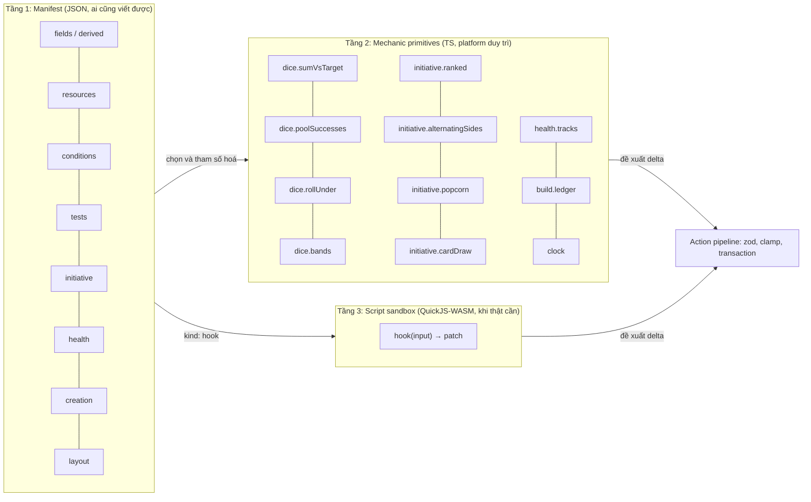
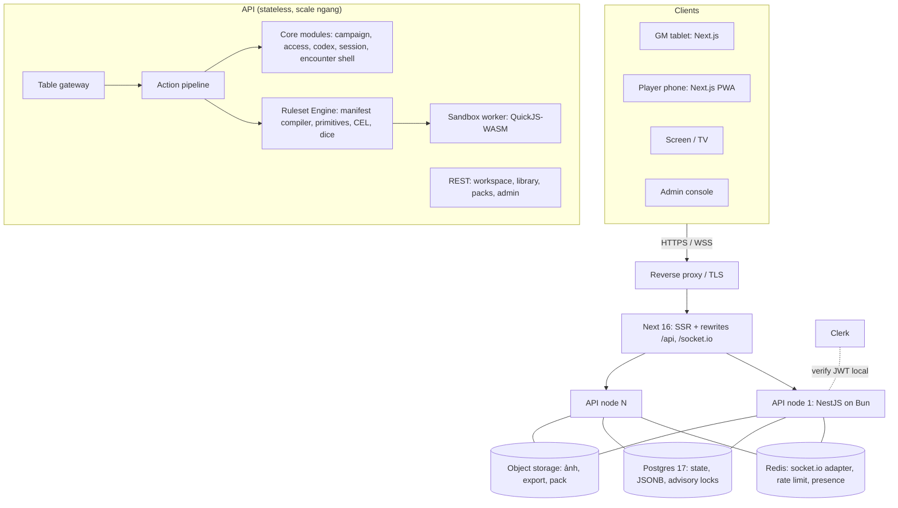
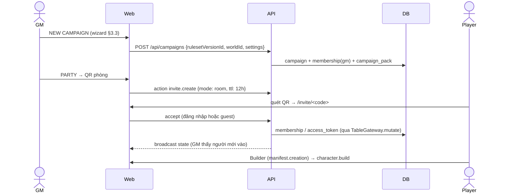
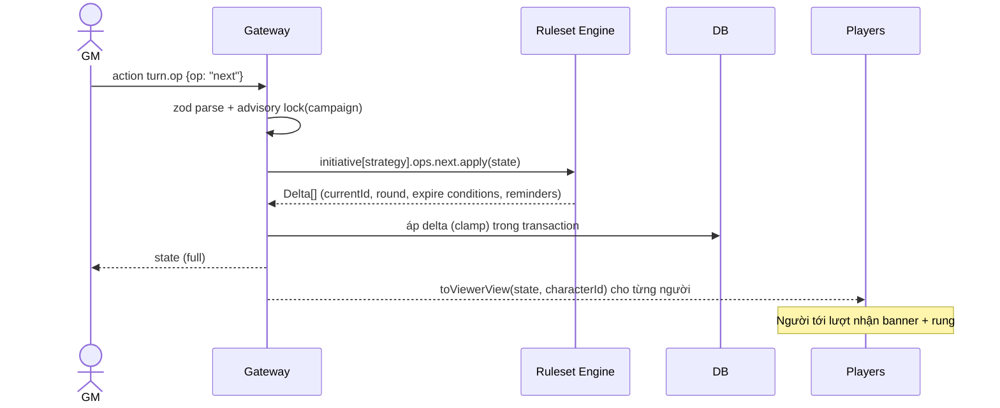

# Auspex Universal: thiết kế lõi cho mọi hệ RPG

> **Trạng thái:** đề xuất (spike), chưa có code. Tài liệu này dựng trên kiến trúc hiện tại của auspex_gm
> (`docs/architecture.md`) và mở rộng nó từ một app cho *Wrath & Glory* thành nền tảng cho **mọi** RPG bàn:
> D&D 5e/2024, Pathfinder 2e, Call of Cthulhu, Blades in the Dark, PbtA, Wrath & Glory, game chiến tranh lịch sử,
> homebrew...
>
> Thuật ngữ kỹ thuật giữ nguyên tiếng Anh. "GM" dùng chung cho GM / DM / Keeper / MC.

---

## 0. Tóm tắt các quyết định chính

| # | Quyết định | Lý do |
|---|---|---|
| D1 | **Giữ nguyên "xương sống" của auspex:** một đường mutation duy nhất (action zod → queue theo campaign → transaction → `authorize` → broadcast), server quyết định, counter nhận delta và bị clamp, snapshot có lọc theo từng người xem. | Mô hình này đã chạy thật tại bàn chơi và không phụ thuộc hệ luật nào. |
| D2 | **Tách lõi (Core) khỏi luật chơi (Ruleset).** Core lo phòng chơi, quyền, codex, session, reveal, realtime. Ruleset lo chỉ số, xúc xắc, initiative, máu, điều kiện, tạo nhân vật. | Hiện W&G nằm cứng trong `character`, `encounter`, `LiveState`, `Action` (xem §2.2). |
| D3 | **Ruleset là một hybrid 3 tầng:** (1) **manifest JSON** khai báo, (2) **registry "mechanic primitives"** viết bằng TS do platform duy trì, manifest chỉ *chọn và tham số hoá*, (3) **script sandbox** (QuickJS-WASM), chỉ thêm khi thật sự cần. | Manifest giúp cộng đồng và GM tự viết luật mà không cần deploy. Primitive giữ cơ chế khó (Wrath die, Seize, rút bài Savage Worlds) ở dạng code có test. Bài học từ Foundry: core sở hữu cơ chế, hệ luật chỉ cấu hình. |
| D4 | **Ba tầng tách bạch: Ruleset (luật), Content Pack (dữ liệu: quái, đồ, phép), World/Setting (bối cảnh, giao diện, từ vựng).** | Cùng luật 5e có thể chơi fantasy, steampunk hay Thế chiến II. Cùng bối cảnh 40k có thể chơi W&G hay một homebrew d20. |
| D5 | **Phiên bản bất biến, campaign "pin" phiên bản.** Encounter snapshot cả stat block lẫn phiên bản ruleset. Homebrew = fork bằng overlay. | Sửa luật không làm hỏng trận đang chơi hay nhân vật cũ. |
| D6 | **Quyền xem khai báo trên từng field** (`public / party / owner / gm`) thay cho `toPlayerView` viết tay. | Hệ luật mới tự có bộ lọc người chơi đúng, không ai phải sửa code lọc. |
| D7 | **Ưu tiên chơi trực tiếp (in-person first):** xúc xắc thật là mặc định. App chỉ ghi kết quả, chỉ tự gieo khi GM bật (bảng ngẫu nhiên, gieo hộ). Bản đồ/VTT là phần mở rộng sau. | Đó là điểm khác biệt so với Roll20 hay Foundry (§1.6). |
| D8 | **Bản quyền theo lớp nội dung:** SRD 5.1/5.2 (CC-BY-4.0), ORC, CC-BY được chia sẻ công khai. Sách có bản quyền chỉ là **nội dung riêng** của người dùng, gói trong campaign của họ. | Mở rộng nguyên tắc copyright đang có trong `CLAUDE.md`. |

---

## 1. Phân tích nghiệp vụ: một phòng chơi RPG gồm những gì

### 1.1 Tác nhân (actors)

Vai trò gắn với **từng campaign**, không gắn với tài khoản: một người có thể là GM ở bàn này và người chơi ở bàn khác.

| Tác nhân | Mô tả | Có trong auspex? |
|---|---|---|
| **Platform Admin** | Người vận hành dịch vụ, đứng ngoài mọi bàn (§3.1). | Có (`/admin`, `Ctx.admin`) |
| **Creator** | Tài khoản được phép tạo phòng chơi. Ở bản platform: mọi user, giới hạn theo gói (plan). | Có (`publicMetadata.role = creator`) |
| **GM (owner)** | Tạo phòng, thấy mọi thứ, soạn nội dung, quyết định reveal. | Có |
| **Co-GM** | GM phụ, có quyền giới hạn theo scope: chỉ chạy combat, hoặc sửa codex nhưng không xem secret. | **Mới** |
| **Player** | Giữ một hoặc nhiều nhân vật: nhân vật chính, tuỳ tùng, sidekick, funnel 4 nhân vật kiểu DCC. | Có (một nhân vật/ghế) |
| **Guest** | Vào bằng QR, không cần tài khoản, giữ một nhân vật (pregen, nhân vật mượn) trong một hay nhiều buổi. | Có (`access_token`) |
| **Spectator / Screen** | Màn hình TV/chiếu chỉ đọc, hoặc người xem stream. Không bao giờ thấy secret. | Có một phần (screen mode) |

### 1.2 Các "hộp chứa" (containers)

```
Workspace (tài khoản)
 └─ World / Setting (tuỳ chọn, dùng chung cho nhiều campaign, như West Marches)
     └─ Campaign  ── pin: Ruleset@version + Content Packs + House rules + Safety
         ├─ Adventure / Arc
         │   └─ Scene (code auspex gọi là beat): mục tiêu, cast, địa điểm, test dự kiến, encounter dự kiến
         ├─ Session (buổi chơi): ngày, điểm danh, reset pool, thưởng, recap, log
         ├─ Encounter (combat / social / chase / heist / skill challenge / bẫy)
         └─ Codex: NPC, Location (cây), Faction, Item, Handout, Quest, Lore, Calendar
```

### 1.3 Thực thể codex (đều trung lập với hệ luật)

- **NPC:** chân dung, động cơ, thái độ, quan hệ, secret, và *tham chiếu* tới stat block (bestiary, custom hoặc quick).
- **Bestiary / Threat / Monster:** dữ liệu sách (content pack), homebrew, biến thể đã scale.
- **Location:** dạng cây (hệ sao → hành tinh → thành phố → quận → phòng), có hazard.
- **Faction:** thái độ, danh tiếng, clock tiến độ.
- **Item:** catalogue, instance, tiền tệ, đồ của party.
- **Handout:** chữ, ảnh hoặc "đạo cụ" theo style của world. Audience: tất cả, một số nhân vật, hoặc ẩn.
- **Quest / Objective:** của cả party hoặc cá nhân, trạng thái open / done / failed / secret.
- **Lore, Rumour, Secret:** secret có thể được *từng nhân vật* khám phá, không chỉ toàn bàn.
- **Calendar:** ngày trong thế giới (downtime, lễ hội, đếm ngược), tách khỏi lịch chơi ngoài đời.

### 1.4 Văn hoá bàn chơi (thường bị các tool khác bỏ qua)

- **House rules:** quyết định thay luật sách, có thể bật/tắt từng luật biến thể (variant rules), và nguồn sách được phép dùng.
- **Safety tools:** Session Zero, Lines & Veils, X-Card (người chơi chạm trên điện thoại, chỉ GM nhận, ẩn danh), Open
  Door, Script Change, và Stars & Wishes cuối buổi.
- **Lịch chơi:** bình chọn ngày, ngày buổi sau (auspex đã có file `.ics`), nhắc lịch.

### 1.5 Nhịp chơi và kinh tế

Progression (XP theo buổi, milestone, advance), chia loot, quỹ party, downtime, nghỉ ngơi (short/long rest, refocus),
travel (supplies, kiệt sức), clock tiến độ kiểu Blades.

### 1.6 Điểm đau của GM với các tool hiện có (cơ hội cho Auspex)

1. **VTT mặc định chơi online, lấy bản đồ làm trung tâm.** Khi chơi trực tiếp, laptop thành bức tường giữa GM và người
   chơi.
2. **Khởi động mất 20 phút:** cài đặt, tạo tài khoản, đăng nhập 5 điện thoại. Auspex đã có QR guest; giữ và phát huy.
3. **Combat tracker chỉ giả định d20 + Dex.** Thiếu initiative xen kẽ hay popcorn, mob, máu nhiều track, luật chết theo
   loại kẻ địch, undo.
4. **Secret chỉ có bật/tắt.** Thiếu trạng thái "biết tên nhưng không biết chỉ số", không reveal được cho riêng một
   nhân vật.
5. **Prep nằm rải rác ở 4 tool:** Notion/World Anvil, D&D Beyond, VTT, Discord.
6. **Người chơi chuộng xúc xắc thật:** tool hoặc ép gieo số, hoặc bỏ qua kết quả. Auspex đã có "GM gọi Test → người
   chơi báo PASSED/FAILED".
7. **Pool chung** (Glory, Momentum, Doom, Bennies) phải ghi ra giấy nháp.
8. **Thủ tục cuối buổi** (XP, recap, loot, hẹn buổi sau) bị bỏ qua vì mọi người đang dọn đồ.
9. **House rules và errata nằm trong đầu GM;** đổi edition (5e → 2024) là hỏng nhân vật.

---

## 2. Từ auspex_gm hiện tại đến lõi đa hệ

### 2.1 Những gì giữ nguyên (đã trung lập)

- **Đường mutation duy nhất:** `TableGateway.onAction` → `Action.safeParse` → `serial(campaignId)` → `db.transaction`
  → `applyAction` (`authorize` → `dispatch`) → `kicks` → `broadcast(touches)`. REST cũng đi đường này
  (`TableGateway.run`), ví dụ admin housekeeping và invite accept.
- **Hai snapshot** `LiveState` / `Codex`, room `c:<id>:gm` và `c:<id>:players`, view lọc theo từng `characterId`.
- **Access:** `membership`, guest `access_token` (SHA-256), `invite` (room / character, hết hạn, `maxUses`),
  `Ctx { campaignId, role, characterId, userId, admin }`, Clerk cô lập trong `packages/auth`.
- **Codex:** adventure → beat/scene, location (cây, chống vòng lặp), NPC, faction, handout (audience, style), item, ảnh,
  `@mention`, session (recap / GM notes).
- **Character library** (nhân vật ngoài campaign), **content pack** (key, cha trước con), export/import có remap id.
- **Rate limit**, `admin_event`, `image.store.ts` (điểm thay sang S3).

### 2.2 Những gì là W&G và phải thành Ruleset module

| Khu vực | Đang mã hoá ở | Thành phần ruleset tương ứng |
|---|---|---|
| Pool Wrath/Glory/Ruin, reset đầu buổi | cột `campaign.glory/ruin`, `character.wrath`, `poolMax`, `session.start` | `resources[]` với `scope` (entity/party/gm) và `resetOn` |
| Chỉ số nhân vật | cột `wounds/shock/xp…`, `CharacterStats`, `deriveStats` | `entities.character.fields` + `derived` (biểu thức) |
| Tier | `campaign.tier` 1–5 | field cấp campaign do ruleset khai báo (`campaignFields`) |
| Initiative xen kẽ, Seize, ambush | `encounter.lastSide/seizedSide`, `sideUpNext`, `canSeize`, `canAct` | primitive `initiative.alternatingSides` |
| Loại kẻ địch, luật chết | `ThreatClass`, `threatStatus/pcStatus`, mob | `health.tracks` + `health.states` + `mob` |
| Condition | `CONDITIONS`, `TIMED_CONDITIONS`, reminder | `conditions[]` có effects, thời hạn, reminder |
| Test (pool d6, DN, Icon, Wrath die) | `test-call.ts`, `test_call`, `DN_TABLE` | `tests{}`: primitive `dice.poolSuccesses` |
| Corruption / Mutation | `corruption.ts`, `mutation.ts` | resource + roll table + effects |
| Tạo nhân vật, XP ledger | `build.ts` (~2500 dòng), `creation/*.json` | `creation[]` (các bước) + `progression` + primitive `build.ledger` |
| Wargear, requisition | `wargear.ts`, `requisition.ts` | entity `item` + primitive `economy.requisition` |
| Nguồn sách, cite | `source.ts` `SOURCES` | `sources[]` trong manifest + content pack |

> **Kiểm chứng tính tương đương (parity test):** W&G trở thành **manifest đầu tiên** (`wng@1.0.0`). Mọi test hiện có
> trong `packages/shared` phải chạy qua engine chung mà vẫn xanh. Đây là điều kiện để coi việc tách lõi là thành công.

---

## 3. Chức năng theo vai trò

Ký hiệu: **[MVP]** = bản đầu, **[Sau]** = giai đoạn sau. **[Có]** = auspex đã có, chỉ cần tổng quát hoá.

### 3.1 Admin Console (người vận hành platform)

| Mục | Chức năng |
|---|---|
| **Dashboard** | [MVP] số user, phòng đang chạy, session live, lỗi, dung lượng. [Sau] biểu đồ dùng theo ruleset |
| **Users** | [Có] danh sách, vai trò, xoá ghế. [MVP] khoá/mở tài khoản, đổi plan, xem campaign của user. [Sau] impersonate chỉ đọc (ghi audit), export/xoá dữ liệu (GDPR) |
| **Rooms / Campaigns** | [Có] danh sách game, housekeeping action. [MVP] lọc theo ruleset, chủ phòng, hoạt động gần nhất; **chuyển quyền chủ phòng** khi GM rời; archive/restore; force-end session bị treo |
| **Characters** | [MVP] tìm nhân vật theo user/campaign, khôi phục nhân vật đã xoá (soft delete), xem nhân vật lỗi migrate |
| **Rulesets & Packs** | [MVP] duyệt ruleset/pack công khai (license phải là SRD/ORC/CC-BY), feature flag theo ruleset. [Sau] kho cộng đồng, CI kiểm tra lại mọi manifest khi lên phiên bản core |
| **Moderation** | [MVP] nút "report" trên nội dung chia sẻ (handout, ảnh, trang campaign công khai), hàng đợi xử lý, gỡ nội dung. [Sau] quét ảnh tự động, quy trình DMCA |
| **Audit log** | [Có] `admin_event`. [MVP] mở rộng: đổi role, chuyển chủ phòng, gỡ nội dung, phát token guest |
| **Quotas & Plans** | [MVP] giới hạn số campaign/user, người chơi/phòng, dung lượng upload. [Sau] gói trả phí (thường chỉ GM trả, người chơi miễn phí) |
| **Hệ thống** | [Sau] status page, backup/restore theo campaign, telemetry |

### 3.2 Workspace của người dùng (thay lobby): "quản lý phòng, campaign, nhân vật của tôi"

- **Phòng/Campaign của tôi:** đang làm GM, đang chơi, đã archive. Nhân bản (clone) một campaign. Import/export.
- **Nhân vật của tôi:** library nhân vật theo ruleset (mở rộng `library_character`), đưa vào campaign.
- **Ruleset & Pack của tôi:** homebrew riêng (fork từ ruleset gốc), pack nội dung riêng (sách mình sở hữu).
- **World của tôi:** bối cảnh dùng chung nhiều campaign: lore, bản đồ ảnh, theme giao diện, từ vựng.
- **Tạo phòng mới:** wizard ở §3.3.

### 3.3 Wizard dựng một game hoàn chỉnh (mở rộng NEW CAMPAIGN hiện tại)

| Bước | Nội dung | Ghi chú |
|---|---|---|
| 1. **Hệ luật** | Chọn ruleset + phiên bản (5e SRD 2024, PF2e ORC, W&G private, PbtA, "Freeform"), bật content pack | "Freeform" = ruleset tối thiểu (chỉ ghi chú + một track máu) cho game tự chế |
| 2. **Bối cảnh** | Chọn World (hoặc tạo mới): fantasy, 40k, WW2, cyberpunk... Theme giao diện, từ vựng (Agent/Threat hay Party/Monster) | Theme hiện tại "Imperial Manuscript" trở thành theme của World 40k |
| 3. **Quy mô và mức khởi đầu** | Cấp/tier khởi đầu, cách tạo chỉ số (point buy / array / roll), nguồn sách được phép | Lấy từ `manifest.options` |
| 4. **Table talk / Session Zero** | Thể loại, tông (u tối, hài, kinh dị), Lines & Veils, bật X-Card, kỳ vọng | Có sẵn `kind[]`, `limits[]`; tổng quát hoá |
| 5. **House rules** | Bật/tắt variant rules của ruleset (flanking, encumbrance...), viết house rule kèm patch | Lưu `campaign.houseRules[]`, áp như overlay (§4.5) |
| 6. **Party** | Slot nhân vật, pregen, QR phòng, link mời theo nhân vật, cho phép guest | [Có] RoomInvite; giữ nguyên |
| 7. **Lịch** | Ngày giờ buổi đầu, địa điểm, nhắc lịch | [Có] `.ics` |
| 8. **Adventure đầu tiên** | Trống, từ template, hoặc từ pack (one-shot) | Pack load qua action thường như `seed.ts` |

Mỗi bước đều bỏ qua được. **"Quick game":** chọn ruleset → QR → chơi trong dưới 2 phút.

### 3.4 Chức năng GM (tablet/laptop)

| Module | MVP | Sau |
|---|---|---|
| **SETUP** | Checklist sẵn sàng, đổi ruleset option, house rules, safety, export | Nâng phiên bản ruleset có dry-run diff |
| **PREP** | Adventure → scene; scene gắn NPC, location, handout, test dự kiến, encounter dự kiến; encounter builder từ bestiary với **ngân sách độ khó** do ruleset định nghĩa (5e: XP budget; W&G: threat budget) | Checklist prep kiểu "Lazy DM", generator ngẫu nhiên, sơ đồ scene kéo thả |
| **LIVE (TRACK)** | Bắt đầu/kết thúc session (reset resource theo `resetOn`, điểm danh), scene đang diễn ra, nút reveal; **Gọi Test** theo dice mechanic của ruleset; duyệt **request** của người chơi (tiêu pool, reaction) | Log dòng thời gian, đồng hồ nhịp, theo dõi spotlight ("người chơi B lâu chưa được hành động") |
| **Combat tracker** | Initiative theo strategy của ruleset; delta máu/resource; condition có thời hạn tự hết; reminder đầu/cuối lượt; ẩn combatant; mob; command line [Có]; undo phía client [Có] | Legendary/lair action, reaction, undo phía server (event log) |
| **Bestiary / Threat** | Tìm, thêm N con tự đánh số, snapshot; threat builder custom [Có] | Scale/template, quick mook |
| **Secret / Reveal** | Hiển thị theo từng entry: ẩn / đã reveal / reveal cho từng nhân vật; "chỉ thanh máu" [Có] | Reveal một phần (biết tên, chưa biết stat), secret khám phá theo từng nhân vật |
| **Clocks** | Clock 4/6/8 ô, đếm ngược, track Doom/Threat | Clock liên kết (lượt faction) |
| **Bảng ngẫu nhiên** | d6/d66/d100/có trọng số, gieo xong dán vào ghi chú [Có `roll-table.ts`] | Bảng lồng nhau, oracle (Mythic), sinh tên |
| **CODEX** | NPC, location, faction, item, handout (5 style [Có] → style theo World), quest, lore, ảnh, @mention, tìm kiếm [Có] | Đồ thị backlink, chỉnh sửa song song với co-GM |
| **PARTY** | Session và recap, mời (QR/link), guest, sheet nhân vật (GM sửa / override), trao XP và loot | Hàng đợi duyệt thưởng, danh tiếng faction |
| **RULES** | Tra cứu condition/trait theo ruleset, chạm là đọc, có cite trang [Có] | Liên kết tới PDF riêng của GM (relay `book:*` [Có]) |
| **Safety** | Nhận tín hiệu X-Card ẩn danh, xem Lines & Veils ngay trong prep | Phản hồi Stars & Wishes |
| **Cuối buổi** | Wizard gom tất cả: XP, recap, loot, ngày buổi sau | Tự soạn nháp recap từ log |
| **Print** | Thẻ threat, item, handout [Có, react-pdf] → layout theo ruleset | |

### 3.5 Chức năng người chơi (điện thoại)

| Module | MVP | Sau |
|---|---|---|
| **Vào phòng** | QR/link → chọn hoặc nhận nhân vật; guest không cần tài khoản; tự kết nối lại [Có] | Phòng chờ duyệt, nhiều nhân vật, spectate |
| **Builder** | Các bước tạo nhân vật theo `manifest.creation`, kiểm tra hợp lệ, XP/point ledger; **lối thoát nhập tay** | Import D&D Beyond / Pathbuilder JSON, wizard lên cấp |
| **SHEET** | Render từ `layout` của ruleset (phone-first); resource có nút ±; số dẫn xuất chạm vào thấy cách tính ("vì sao Defence = 5?") kèm cite | Chế độ offline |
| **Resource / Phép** | Slot, điểm, prepared/known, metacurrency (Inspiration, Fate, Glory) | Thẻ phép (concentration, thành phần) |
| **Inventory** | Đồ, số lượng, đang trang bị, tiền | Encumbrance, attunement, kho party có log |
| **FIGHT** | Trận đấu theo mức GM cho thấy; banner "đến lượt bạn" + rung [Có] | |
| **Test được gọi** | Nhận prompt, xem pool/DC, gieo **xúc xắc thật**, báo kết quả [Có, tổng quát hoá theo mechanic] | Gieo số (GM bật), ghi log |
| **Request** | Xin tiêu pool, dùng reaction; GM duyệt [Có `spend_request`] | Xin tiêu XP, hành động downtime |
| **INTEL** | NPC, location, faction đã biết; handout; quest; recap; buổi tới [Có] | Bản đồ quan hệ, bảng tin đồn |
| **Ghi chú** | Ghi chú riêng (chỉ chủ nhân vật thấy) | Nhật ký party chung |
| **Safety** | Nút X-Card ẩn danh | |
| **RULES** | Tra cứu theo ruleset [Có] | |

---

## 4. Ruleset Engine: chơi được mọi thể loại

### 4.1 Mô hình 3 tầng



| | Platform | Cộng đồng | GM homebrew |
|---|---|---|---|
| Manifest | ✔ | ✔ | ✔ |
| Primitive | ✔ | ✘ (gửi PR) | ✘ |
| Script | ✔ | phải được duyệt | chỉ trong campaign của mình |

Script **không bao giờ ghi state trực tiếp.** Nó trả về một patch, và patch đó đi qua đúng pipeline zod → clamp →
transaction như mọi action.

### 4.2 Phác thảo manifest (zod)

```ts
const Visibility = z.enum(["public", "party", "owner", "gm"]);

export const Ruleset = z.object({
  id: Id, version: SemVer, core: SemVerRange,           // tương thích với API primitive của core
  extends: z.object({ id: Id, version: SemVer }).optional(), // fork / homebrew
  sources: z.array(Source),                            // { id, title, license: srd|orc|cc-by|private, pageOffset }
  terms: z.record(Id, z.string()),                     // từ vựng: { party: "Agents", foe: "Threats", hp: "Wounds" }
  campaignFields: z.record(Id, FieldDef),              // W&G: tier; 5e: không có
  options: z.array(RuleOption),                        // variant rules để GM bật/tắt
  entities: z.array(EntityType),                       // character, threat/monster, item, ability, spell
  resources: z.array(Resource),                        // máu, slot phép, Glory (party), Ruin (gm), clock
  conditions: z.array(Condition),
  tests: z.record(Id, DiceMechanic),                   // skill, save, attack, sanity...
  initiative: Initiative,
  health: Health,
  creation: z.array(CreationStep),
  progression: Progression,
  encounterBudget: Budget.optional(),
  layout: z.record(Id, Layout),                        // gợi ý bố cục, KHÔNG phải HTML
  migrations: z.array(Migration).default([]),
});

const Resource = z.object({
  id: Id, label: z.string(),
  scope: z.enum(["entity", "party", "gm", "campaign"]),
  min: Expr.default("0"), max: Expr.optional(),         // "derived.maxWounds"
  resetOn: z.array(z.object({ event: z.enum(["sessionStart", "sessionEnd", "encounterEnd", "shortRest", "longRest"]),
                              to: Expr })).default([]),
  visibility: Visibility.default("owner"),
});

const Effect = z.object({                              // kiểu ActiveEffects, nhưng thứ tự rõ ràng
  path: z.string(), mode: z.enum(["add", "multiply", "override", "upgrade", "downgrade"]),
  value: Expr, phase: z.enum(["base", "derived"]).default("base"), priority: z.number().optional(),
  when: Expr.optional(),
});
```

**Ví dụ: cùng một engine, ba hệ luật**

```jsonc
// D&D 5e (SRD 5.2): HP + death save, initiative d20 + Dex
{ "tests": { "check": { "kind": "sumVsTarget", "dice": "1d20", "modifier": "mod(attr[skill.attr]) + prof(skill)",
                        "target": "ctx.dc", "advantage": true, "critOn": [20] } },
  "initiative": { "strategy": "ranked", "score": "1d20 + mod(attr.dex)", "rerollEachRound": false },
  "resources": [{ "id": "hp", "scope": "entity", "max": "derived.maxHp", "resetOn": [{ "event": "longRest", "to": "max" }] },
                { "id": "inspiration", "scope": "entity", "max": "1" }] }

// Wrath & Glory: pool d6, Icon, Wrath die, initiative xen kẽ + Seize
{ "tests": { "skill": { "kind": "poolSuccesses", "die": 6, "pool": "attr[skill.attr] + skill.rank",
                        "faces": { "4": 1, "5": 1, "6": 2 }, "special": [{ "id": "wrath", "count": "1",
                        "faces": { "1": "complication", "6": "critical" } }], "target": "ctx.dn", "shift": { "face": 6 } } },
  "initiative": { "strategy": "alternatingSides", "firstSide": "players", "ambush": true,
                  "seize": { "cost": [{ "resource": "glory", "amount": 1 }], "oncePerTurn": true } },
  "resources": [{ "id": "glory", "scope": "party", "max": "6", "resetOn": [{ "event": "sessionStart", "to": "0" }] },
                { "id": "ruin", "scope": "gm", "resetOn": [{ "event": "sessionStart", "to": "count(players)" }] }] }

// Call of Cthulhu 7e: d100 roll-under, Sanity
{ "tests": { "skill": { "kind": "rollUnder", "dice": "1d100", "target": "skill.value",
                        "degrees": [{ "id": "extreme", "at": "target / 5" }, { "id": "hard", "at": "target / 2" }] } },
  "initiative": { "strategy": "ranked", "score": "attr.dex", "rerollEachRound": false },
  "resources": [{ "id": "san", "scope": "entity", "max": "99 - skill.cthulhuMythos" }] }
```

### 4.3 Biểu thức và xúc xắc

- **Ngôn ngữ biểu thức: CEL** (`@marcbachmann/cel-js`, thư viện nhẹ, có kiểu, không Turing-complete). Phương án dự
  phòng: tự viết parser Pratt (~400 dòng) ra JSON AST.
  - Compile khi load manifest. Định danh lạ là lỗi load.
  - Đồ thị phụ thuộc của `derived` được sắp topo; có vòng lặp là lỗi load.
  - Chỉ có hàm trong whitelist (`min max floor ceil clamp count sum has mod prof`), số học nguyên, quy tắc làm tròn
    khai báo trong manifest.
  - Chạy giống hệt ở web (xem trước) và api (quyết định). Server luôn là bên quyết định.
- **Xúc xắc:** dùng ngữ pháp riêng, nhỏ: `NdX`, `+/-`, `kh/kl`, `!` (explode), `>=T` (đếm thành công), `d66`, `dF`.
  - Khi app gieo: gieo ở server bằng `crypto.getRandomValues`, lưu `roll_event { notation, faces[], result, by }`.
  - Khi người chơi gieo xúc xắc thật: kết quả được gắn cờ `reported`.

### 4.4 Thứ tự áp effect (bài học từ Foundry)

`base fields` → effects `phase: base` (theo `priority`, rồi `source id`) → tính `derived` → effects `phase: derived`
→ clamp. UI có màn **"Breakdown"** chỉ rõ từng nguồn cộng/trừ kèm cite trang. Màn này thay việc phải tra sách.

### 4.5 Phiên bản, migrate, fork, house rules

- `ruleset_version` là **bất biến** (`id`, `version`, `hash`, `manifest jsonb`). Sửa lỗi = phát hành phiên bản mới.
- Campaign pin `ruleset@version`. Mỗi character lưu `{ rulesetVersion, data }`. Encounter snapshot stat block và
  phiên bản (như `statSnapshot` hiện tại).
- **Migration khai báo** trong manifest mới (`rename`, `default`, `mapEnum`, `drop` có `archive`). GM bấm nâng cấp, xem
  dry-run diff, rồi mới áp. Không bao giờ tự động.
- **Homebrew = fork:** `extends: dnd5e-srd@2.0.0` + overlay theo `id` (không theo vị trí mảng). Khi bản gốc lên
  phiên bản: hiện diff 3 chiều, GM tự rebase.
- **House rules:** `campaign.houseRules[] = { id, text, patch? }`. Có `patch` thì engine áp như overlay; chỉ có `text`
  thì là ghi chú cho bàn. Thay cho `rules-flow.md` §11 ở cấp platform. Repo auspex vẫn giữ §11 cho luật W&G của nó.

### 4.6 Content pack và bản quyền

- **Pack** = `{ id, version, ruleset: range, license, attribution, visibility, entries[] }`. Key có namespace `pack:key`.
- **Công khai:** chỉ `srd | orc | cc-by`, attribution hiện trong UI. Kho mặc định gồm 5e SRD 5.2 (CC-BY-4.0), PF2e
  ORC (trừ Reserved Material) và các ruleset tự viết.
- **Riêng tư:** nội dung sách có bản quyền (W&G, CoC...) là pack thuộc user hoặc campaign, không liệt kê, không share
  link công khai, không phục vụ cho người không có ghế. Đây là tổng quát hoá các gate hiện có (`/threats`, `/wargear`
  chỉ GM; `/rules` theo ghế). Trang sách vẫn chỉ đến người chơi qua relay trực tiếp từ PDF của GM (`book:*`), không
  lưu gì.
- **Hiển thị theo từng entry:** stat block `gm` không bao giờ rời room GM.

### 4.7 World / Setting: "bất cứ thế giới nào người chơi nghĩ ra"

World là lớp **trình bày và lore**, tách khỏi luật:

- **Theme:** CSS token (màu, font, texture), giống cách `docs/frontend.md` §7 định nghĩa Imperial Manuscript.
  Ví dụ: "Parchment" (fantasy), "Field Manual" (WW2), "Neon" (cyberpunk).
- **Từ vựng:** ghi đè `terms` của ruleset (ví dụ "Squad" thay "Party", "Casualties" thay "HP").
- **Kiểu handout:** thư tay, điện tín, lệnh quân sự, vox, decree, terminal. Nâng 5 style hiện có thành registry.
- **Lore chung:** location, faction, NPC ở cấp World được nhiều campaign kế thừa (West Marches).

---

## 5. Kiến trúc kỹ thuật

### 5.1 Tổng thể



### 5.2 Package trong monorepo

```
packages/
  core-schema/     zod: Ctx, Membership, Codex, Session, Clock, Request, core actions (trung lập)
  rules-engine/    manifest zod, compiler (CEL → AST), dependency graph, effect stack, dice grammar,
                   primitive registry (dice.*, initiative.*, health.*, build.*), toViewerView (theo visibility)
  rulesets/        wng/ (manifest + test parity), dnd5e-srd/, pf2e-orc/, coc-lite/, pbta-generic/, freeform/
  packs/           SRD content pack (CC-BY), pack loader + validator
  auth/            giữ nguyên (@wg/auth)
apps/
  api/             core modules + ruleset module + workspace + admin
  web/             GM app, player app, admin, builder và sheet renderer chung (render từ layout)
```

### 5.3 Pipeline action tổng quát hoá

Hiện tại `Action` là một union đóng. Đề xuất chia hai lớp:

1. **Core actions** (union đóng, như hiện nay): `campaign.*`, `session.*`, `invite.*`, `member.*`, `token.*`,
   `codex.*`, `encounter.add/remove`, `clock.*`, `request.*`, `safety.signal`.
2. **Ruleset actions** (generic, payload kiểm tra lúc runtime theo manifest):
   - `res.adjust { target, resource, delta }`: mọi counter (HP, Wounds, Glory, slot phép...). Clamp
     `[eval(min), eval(max)]` bằng `bump()`.
   - `field.set { target, path, value }`: ghi field; kiểm tra theo `FieldDef` và quyền.
   - `effect.apply / effect.remove { target, conditionId | effect }`.
   - `turn.op { op, params }`: chuyển cho `initiative.<strategy>.step(state, op)`. W&G có `seize`; Savage Worlds có
     `draw`.
   - `test.call / test.report / test.close { mechanicId, params }`: tổng quát hoá `test_call`.
   - `rule.op { primitive, params }`: các thao tác khác của primitive (build, requisition...). Params kiểm tra bằng
     zod schema mà primitive đăng ký.

```ts
// Hợp đồng của một primitive (packages/rules-engine)
interface Primitive<P, S> {
  id: string;                         // "initiative.alternatingSides"
  params: z.ZodType<P>;               // tham số từ manifest
  ops: Record<string, {
    input: z.ZodType;                 // payload của turn.op / rule.op
    who: "gm" | "owner" | "player";   // authorize() đọc từ đây, thay PLAYER_ACTIONS viết tay
    apply(ctx: RuleCtx<P, S>, input): Delta[];   // THUẦN: chỉ đề xuất delta
    touches: "state" | "codex" | "both";
  }>;
}
```

`authorize`, `touches`, `kicks` không còn đọc tên action viết tay: **core** khai báo cho core action, **primitive**
khai báo cho ruleset action. Khi thêm hệ luật mới không phải sửa `dispatch`.

### 5.4 Mô hình dữ liệu (Postgres)

Nguyên tắc: **cột có kiểu cho core, JSONB cho dữ liệu ruleset.** Index GIN cho truy vấn pack và codex.

| Bảng | Cột chính | Ghi chú |
|---|---|---|
| `app_user` | id (Clerk), name, plan, status, lastSeenAt | [Có] + plan/status |
| `world` | id, ownerId, name, theme jsonb, terms jsonb, visibility | **Mới** |
| `ruleset` | id, ownerId, slug, visibility, license | **Mới** |
| `ruleset_version` | rulesetId, version, hash, manifest jsonb, extendsVersionId, compiledAt | **Mới**, bất biến |
| `pack` / `pack_version` / `pack_entry` | entry: packVersionId, key, type, data jsonb, visibility, contentHash | Thay `packages/data` tĩnh; pack sách W&G thành pack private |
| `campaign` | id, ownerId, worldId, rulesetVersionId, name, settings jsonb (options, tier...), houseRules jsonb, safety jsonb, archivedAt | Bỏ cột `glory/ruin/tier` |
| `campaign_pack` | campaignId, packVersionId | Pack đang bật |
| `membership` | campaignId, userId, role (`gm`/`cogm`/`player`/`spectator`), scopes text[], characterIds uuid[] | [Có] + co-GM, nhiều nhân vật |
| `invite`, `access_token` | [Có] | Giữ nguyên |
| `character` | id, campaignId, ownerUserId, kind (`pc`/`npc`/`retainer`), name, rulesetVersion, data jsonb, resources jsonb, conditions jsonb, build jsonb, archived jsonb | Thay ~15 cột W&G |
| `library_character` | [Có] + rulesetVersionId | |
| `resource_pool` | campaignId, scope (`party`/`gm`), resourceId, value | Thay `campaign.glory/ruin` |
| `clock` | campaignId, label, segments, filled, visibility, linkedTo | **Mới** |
| `encounter` | campaignId, round, active, rulesetVersion, initiativeState jsonb | `lastSide/seizedSide` nằm trong jsonb |
| `combatant` | encounterId, kind, characterId, statSnapshot jsonb, data jsonb, resources jsonb, conditions jsonb, visibility, order | |
| `test_call` | campaignId, mechanicId, params jsonb, who, reports jsonb | [Có], tổng quát hoá |
| `request` | campaignId, characterId, kind, payload jsonb, status | Tổng quát hoá `spend_request` |
| `roll_event` / `session_event` | campaignId, sessionId, type, payload jsonb, at | **Mới**: log để recap, audit, undo phía server sau này |
| Codex: `adventure`, `scene`, `npc`, `location`, `faction`, `item`, `handout`, `quest`, `lore` | [Có] + `quest`, `lore`; `npc.statSource` trỏ `pack:key` | Thêm `knownBy uuid[]` cho reveal theo nhân vật |
| `image` → object storage | campaignId, key S3, mime, size | Thay `bytea` (điểm swap `image.store.ts`) |
| `safety_signal` | campaignId, kind, at (không lưu ai gửi) | **Mới**, ẩn danh |
| `admin_event`, `report` | [Có] + moderation | |

### 5.5 Lọc dữ liệu theo người xem

`toViewerView(snapshot, viewer)` của `rules-engine` đọc `visibility` trên field, resource, entry codex, combatant:

- `gm`: chỉ room GM (stat quái, secret, ghi chú GM).
- `owner`: chỉ chủ nhân vật và GM (objective cá nhân, corruption).
- `party`: mọi ghế trong campaign.
- `public`: cả màn hình TV và spectator.

Với combatant giữ 3 mức `hidden / bars / stats` [Có]. Codex thêm `knownBy` để reveal cho riêng từng nhân vật.
Bộ lọc vẫn chạy ở server, mỗi `characterId` một lần như `broadcast` hiện nay.

### 5.6 Realtime và mở rộng ngang

Hiện tại một instance là đủ cho vài bàn. Các giới hạn đã được đánh dấu `ponytail:` trong code; với platform nhiều
tenant cần thay:

| Hiện tại | Platform |
|---|---|
| Queue `tails` trong process | `pg_advisory_xact_lock(hashtext(campaignId))` trong transaction (đường nâng cấp đã ghi trong code), hoặc sticky routing theo campaign |
| `fetchSockets` local | `@socket.io/redis-adapter` |
| Rate limit trong process | Redis (sliding window) |
| Gửi toàn bộ snapshot mỗi action | Giữ full snapshot khi connect. Sau đó gửi **patch có số phiên bản** (`stateVersion`, JSON Patch theo từng view); client lệch phiên bản thì xin full. Tách room theo nhân vật |
| `loadCodex` 9 query mỗi lần | Chỉ nạp lại phần `touches` chỉ định (theo loại entry) + cache theo version |
| Ảnh `bytea` | S3/R2, URL ký có hạn, vẫn gate theo ghế |
| Clerk Invite-only để gate `/rules`, `/creation` | Gate theo **license của pack** + membership; mở đăng ký công khai được |

### 5.7 Bảo mật và vận hành

- Mọi query scope theo `ctx.campaignId` [Có]; nội dung private scope theo `ownerId`.
- Sandbox script: Bun Worker + QuickJS-WASM, giới hạn bộ nhớ, ngân sách lệnh, không I/O.
- Audit: role, chuyển chủ phòng, takedown, impersonate, phát token.
- Backup theo campaign = export `auspex-campaign v2` (thêm `rulesetVersion` + pack refs).
- Offline: player PWA giữ snapshot gần nhất (chỉ đọc), xếp hàng request khi mất mạng; Wi-Fi ở cửa hàng game thường
  kém.

---

## 6. Các luồng chính

### 6.1 Tạo phòng và mời người chơi



### 6.2 Một lượt combat (bất kỳ hệ luật nào)



### 6.3 GM gọi Test, người chơi gieo xúc xắc thật

1. GM: `test.call { mechanicId: "skill", params: { skill: "stealth", dc: 15 }, who: [charA, charB] }`.
2. Phone của A, B: prompt hiện pool/modifier đã tính sẵn từ manifest (5e: `d20 + 5`; W&G: `7 dice + Wrath die`; CoC:
   `≤ 45`).
3. Người chơi gieo thật rồi chạm **PASSED / FAILED** (hoặc nhập số; engine tính bậc thành công).
4. GM thấy bảng tổng hợp và đóng Test. Kết quả vào `session_event`.

### 6.4 Kết thúc buổi

Wizard: điểm danh → thưởng XP/milestone (`progression`) → chia loot → recap → reset resource có `resetOn: sessionEnd`
→ ngày buổi sau (`.ics`) → Stars & Wishes (tuỳ chọn).

---

## 7. Lộ trình triển khai

| Giai đoạn | Mục tiêu | Tiêu chí xong |
|---|---|---|
| **P0: Tách engine** | Dựng `rules-engine` (manifest zod, CEL, primitives) từ code `packages/shared` hiện có; viết `wng.ruleset.json` | Mọi test hiện tại xanh khi chạy qua engine (parity) |
| **P1: Schema chung** | `character.data/resources` JSONB, `resource_pool`, `encounter.initiativeState`, `ruleset_version`, pin phiên bản; action `res.adjust / turn.op / test.*` | Một bàn W&G chơi trọn buổi không khác gì bây giờ |
| **P2: Hệ luật thứ hai** | `dnd5e-srd` (SRD 5.2, CC-BY) + pack SRD; sheet renderer từ `layout`; builder chung | Bàn 5e chơi một one-shot SRD từ tạo nhân vật đến hết buổi |
| **P3: Workspace + Wizard + World** | Hub người dùng, wizard 8 bước, theme/terms theo World, house rules overlay, safety tools | Người mới tạo game và mời bàn trong dưới 5 phút |
| **P4: Platform** | Admin console mở rộng (moderation, quotas, chuyển chủ phòng), Redis adapter, advisory lock, S3, patch broadcast | Chạy 2+ instance api; load test 100 bàn đồng thời |
| **P5: Hệ sinh thái** | Fork/homebrew editor, kho cộng đồng, script sandbox, PF2e ORC, PbtA, CoC-lite, Freeform | Một GM tự viết homebrew mà không cần deploy |

**Chiến lược bản quyền khi phát triển:** repo công khai (nếu sau này có) chỉ chứa ruleset tự viết và SRD/ORC. Nội dung
W&G tiếp tục là pack private của deployment hiện tại.

---

## 8. Rủi ro và câu hỏi mở

1. **Manifest phình thành ngôn ngữ dở (inner-platform).** Giảm thiểu: mọi cơ chế mới đi qua primitive registry có
   test và zod params, không chấp nhận "magic string".
2. **Parity W&G tốn công:** `build.ts` dài ~2500 dòng. Phương án: `build.ledger` là primitive TS riêng cho hệ mua bằng
   XP; manifest chỉ khai báo catalogue và chi phí.
3. **Hiệu năng:** full snapshot với campaign lớn. Patch broadcast ở P4; đo trước khi làm.
4. **Pháp lý:** chính sách fan content của GW/Cubicle 7/WotC thường cấm tool thu phí tái hiện nội dung luật. Nếu
   thương mại hoá, chỉ dùng SRD/ORC hoặc xin license. *Cần hỏi ý kiến pháp lý trước khi mở công khai.*
5. **Clerk ở chế độ Open:** chỉ được bật sau khi mọi gate nội dung chuyển sang theo license và membership (§5.6).
6. **Câu hỏi cho chủ sản phẩm:**
   - Có cần chế độ online (bản đồ, VTT nhẹ) không, hay giữ thuần in-person?
   - Mô hình thu phí: chỉ GM trả, hay miễn phí hoàn toàn?
   - Hệ luật thứ hai ưu tiên là gì: 5e SRD (đông người chơi nhất) hay PbtA (đơn giản nhất để kiểm chứng engine)?
   - Co-GM và nhiều nhân vật mỗi người chơi có cần ở MVP không?
